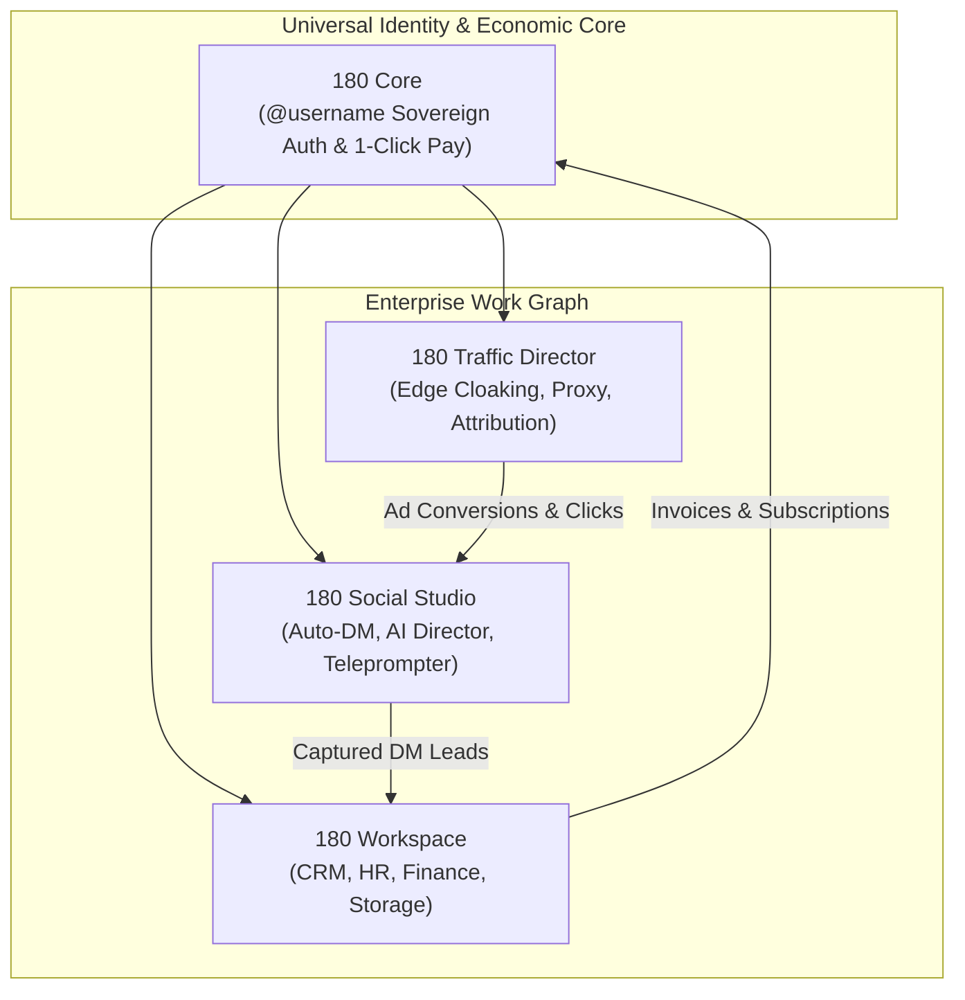

# 180 Platform Ecosystem Overview

Welcome to the **180 Platform** documentation. 180 is a sovereign, unified business and media operating system engineered to eliminate SaaS fragmentation, vendor lock-in, and repetitive operational overhead for modern companies, agencies, and high-velocity creators.



---

## The Philosophy of 180

Modern enterprises and creators are trapped in a web of fragmented micro-SaaS subscriptions:
- A separate CRM (HubSpot / Salesforce)
- A separate HR & payroll tool (Gusto / Rippling)
- A separate social scheduling tool (Buffer / Hootsuite)
- A separate DM automation bot (ManyChat)
- A separate video recording teleprompter app
- A separate link routing and cloaking tool
- A separate payment and authentication gateway (Auth0 / Stripe)

Each tool stores data in isolated silos, forces users to maintain distinct login credentials, charges per-seat tax, and requires fragile Zapier/Make integrations that break silently.

**180 replaces this patchwork with an interconnected Sovereign Work Graph.**

All products share:
1. **Universal Sovereign Account**: One `@username` across the entire ecosystem.
2. **Centralized Billing & Payments**: 1-Click UPI, Card, and Crypto rails via 180 Pay.
3. **Multi-Company Data Isolation**: Strict tenant schemas with dynamic tenant routing.
4. **Cross-Product Event Bus**: Native event propagation without third-party webhooks.

---

## The 4 Sovereign Product Lines

| Product Line | Target Audience | Primary Capabilities |
| :--- | :--- | :--- |
| **[180 Workspace](/docs/products/180-workspace/overview)** | Modern Companies & Agencies | Full-suite CRM, HR team directory, multi-currency invoicing, enterprise cloud storage, and multi-company RBAC. |
| **[180 Social Studio](/docs/products/180-social-studio/overview)** | Content Creators, Media Brands | 1-Click multi-platform video publishing, AI scriptwriting director, front-camera teleprompter, and viral Auto-DM lead capture. |
| **[180 Core](/docs/products/180-core/overview)** | Developers & SaaS Builders | Zero-password authentication via WhatsApp 1-Tap OTP, universal single sign-on, and 1-Click bottom-sheet checkout with BYOG support. |
| **[180 Traffic Director](/docs/products/180-traffic-director/overview)** | Media Buyers, Performance Marketers | Sub-millisecond Cloudflare edge cloaking, threat intelligence bot defense, dynamic macro interpolation, and ad attribution postbacks. |

---

## The Work Graph: Autonomous Cross-App Synergy

In traditional architectures, marketing, sales, and billing run in disconnected databases. In 180, actions in one product autonomously propagate to others:

```mermaid
sequenceDiagram
    autonumber
    actor Visitor as Prospect / Ad Click
    participant TD as 180 Traffic Director
    participant SS as 180 Social Studio
    participant WS as 180 Workspace
    participant Pay as 180 Pay Core

    Visitor->>TD: Clicks High-Velocity Ad Campaign
    TD->>TD: Sub-1ms Edge Inspection (Filters Bots/Spies)
    TD->>SS: Routes to Instagram/TikTok Lead Magnet
    Visitor->>SS: Comments keyword "GROWTH"
    SS->>Visitor: Auto-DM delivers lead magnet with 1-Click link
    SS->>WS: Creates qualified Lead in CRM Deals Pipeline
    WS->>WS: Sales rep closes agreement
    WS->>Pay: Issues dynamic multi-currency Invoice with 1-Tap checkout
    Pay-->>WS: Webhook confirms settlement; funds routed
```

---

## Architectural Principles

### 1. Sovereign Tenant Isolation
Every company is partitioned logically and cryptographically. Cross-company data leaks are mathematically prevented by automated tenant middleware at the Prisma ORM layer.

### 2. Zero-Knowledge Credentialing
Developer secrets, payment provider API keys (BYOG), and OAuth tokens are AES-256-GCM encrypted at rest with hardware security modules and timing-safe comparisons.

### 3. Edge-First Velocity
Critical traffic evaluation (Traffic Director) and authentication tokens (180 Identity) resolve at edge nodes in under 5 milliseconds.

---

## Navigating the Documentation

- **Tier 1 (Public Platform)**: Understand our vision, sovereign identity, developer ecosystem, and security guarantees.
- **Tier 2 (Products Directory)**: Deep-dive into user guides and feature documentation for [180 Workspace](/docs/products/180-workspace/overview), [180 Social Studio](/docs/products/180-social-studio/overview), [180 Core](/docs/products/180-core/overview), and [180 Traffic Director](/docs/products/180-traffic-director/overview).
