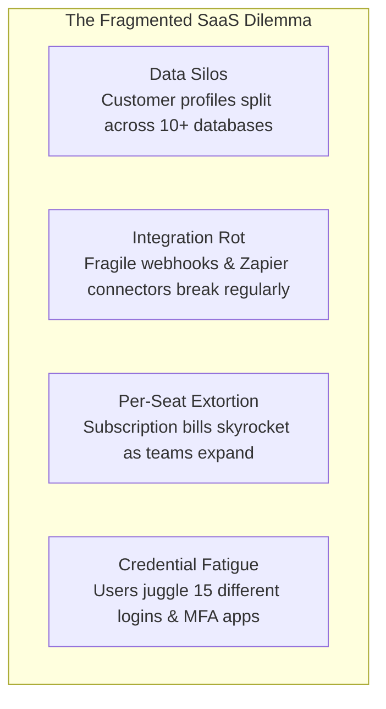
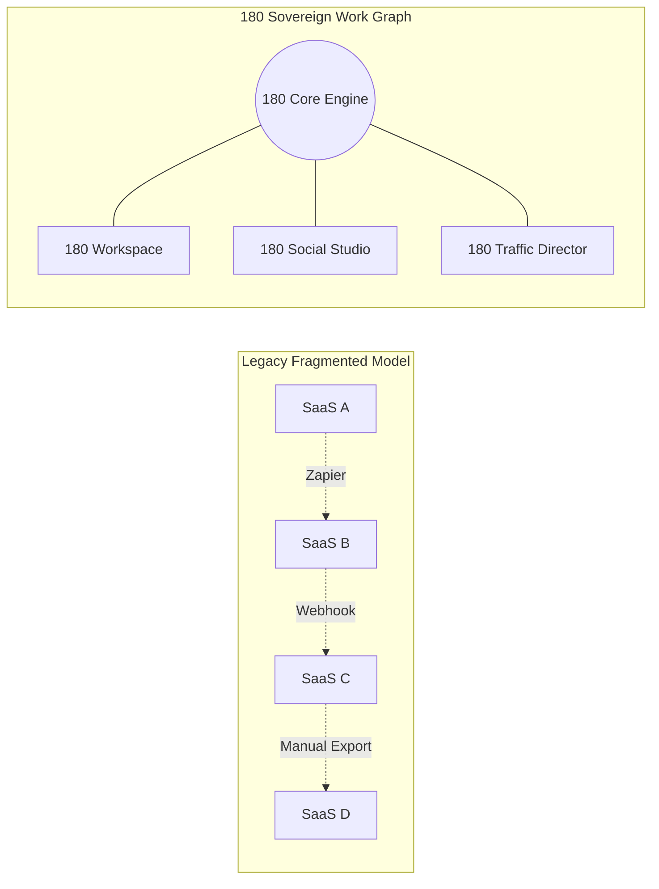

# Product Vision & Purpose

At **180**, we believe that modern businesses, creative studios, and software builders should own their digital sovereignty. The last decade of cloud software forced enterprises into an expensive, fragmented subscription trap where critical operational data is leased from dozens of disconnected platforms.

180 was built to reverse this dynamic.

---

## The Problem: The Fragmented SaaS Tax

Today's business software ecosystem suffers from four fatal structural defects:

### 1. Data Silos & Disconnected Context
When an ad converts on Meta, the click intelligence lives in an ads dashboard, the lead record sits in HubSpot, the conversation unfolds in ManyChat, the project tasks land in Asana, and the payment settles in Stripe. No single team member has an unfragmented view of the customer lifecycle.

### 2. Integration Rot & Synchronization Latency
Connecting disjointed apps requires thousands of brittle webhook triggers, external middleware services, and ongoing maintenance. A single schema change in one external API breaks downstream workflows silently.

### 3. Per-Seat Pricing Tax
Traditional SaaS companies monetize headcount rather than compute consumption. Adding a contract designer, a temporary customer support agent, or an external accountant incurs recurring per-seat fees that penalize organizational agility.

### 4. Vulnerable Identity Surface
Every third-party SaaS tool introduced into a business introduces a new attack vector, credential repository, and compliance liability.

---

## The 180 Solution: Sovereign Unified Operations

180 redesigns the enterprise stack from first principles:

### 1. Unified Work Graph
Instead of syncing records across foreign APIs, all 180 applications operate on an interconnected **Work Graph**. An event triggered in 180 Traffic Director immediately mutates state in 180 Social Studio and surfaces as an actionable deal in 180 Workspace CRM.

### 2. Sovereign Identity Model (`@username`)
Every user in the 180 ecosystem owns a single sovereign identity identified by their `@username`. 
- Zero password fatigue: Instant authentication via WhatsApp 1-Tap OTP or OAuth 2.0 PKCE.
- One-click authorization across all 180 services and third-party developer integrations.

### 3. True Data Sovereignty
Businesses own their database records. Dynamic tenant schema isolation ensures company records are never mixed, co-mingled, or used to train external proprietary models without explicit consent.

### 4. Fair Resource-Based Monetization
180 replaces arbitrary per-seat penalties with clear, predictable platform tiers and compute-based usage. Your entire team can collaborate without paying punitive user licensing penalties.

---

## The Long-Term Horizon

Our mission is to establish 180 as the global default substrate for modern commerce and creative media:

1. **Phase 1 (Consolidation)**: Deliver world-class, integrated alternatives for CRM, HR, invoicing, cloud storage, social publishing, and ad attribution.
2. **Phase 2 (Ecosystem Expansion)**: Provide developers with high-leverage SDKs (`@workspace/identity-sdk`) to build sovereign apps on top of 180 Identity and 180 Pay.
3. **Phase 3 (Autonomous Orchestration)**: Empower autonomous AI agents to operate across the Work Graph, automating administrative busywork while keeping human leaders firmly in control.

---

## Next Steps

- Explore how data moves across products in **[The Sovereign Work Graph](/docs/03-work-graph-architecture)**.
- Learn about zero-password authentication in **[Universal Account & Single Sign-On](/docs/04-universal-account-and-identity)**.
- Browse our dedicated product suites in the **[Products Directory](/docs/products/180-workspace/overview)**.
