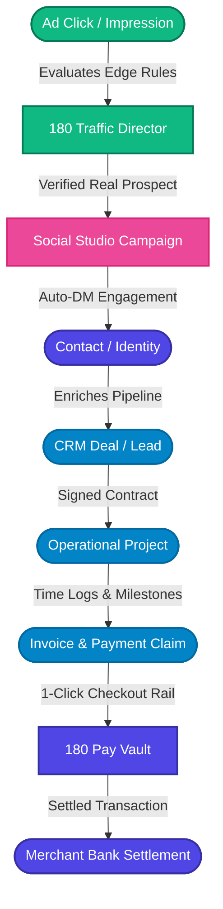
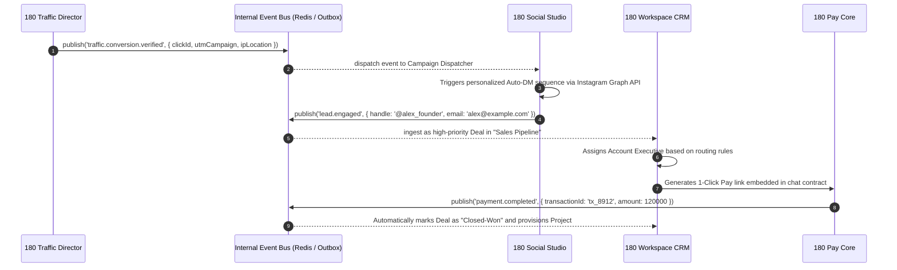

# The Sovereign Work Graph

The **180 Work Graph** is the foundational event-driven relational fabric connecting all four 180 product lines. Rather than treating customer records, communication threads, ad attribution metrics, and financial ledgers as isolated relational tables, the Work Graph models operational entities as vertices connected by directed, event-driven edges.

---

## 1. Graph Topology: Nodes & Edges

Every entity in the 180 ecosystem belongs to a well-defined node archetype in the graph:

| Node Archetype | Originating Product | Description |
| :--- | :--- | :--- |
| **Identity Node** (`AppUserIdentity`) | 180 Identity | Sovereign individual user identified by `@username`, mobile number, or OAuth identity. |
| **Company Node** (`Company`) | 180 Workspace | Sovereign business organization with isolated schema and RBAC policy. |
| **Traffic Node** (`TrafficRule`, `EvaluationLog`) | 180 Traffic Director | Real-time edge routing filter, cloaking verdict, and ad tracking macro state. |
| **Media Node** (`MediaProject`, `AutoDmTrigger`) | 180 Social Studio | Video assets, script drafts, scheduled posts, and keyword DM dispatchers. |
| **Commercial Node** (`Lead`, `Deal`, `Contact`) | 180 Workspace CRM | Sales pipeline stages, customer conversation histories, and value forecasts. |
| **Financial Node** (`Invoice`, `PaymentSession`) | 180 Pay & Workspace | Cryptographically verified billing contracts, subscription schedules, and payouts. |

---

## 2. Cross-Product Event Bus

Data synchronization across products does not rely on polling or external webhooks. Instead, 180 utilizes an internal, zero-latency event bus with Redis Pub/Sub and transactional outbox persistence in PostgreSQL:

---

## 3. Real-World Work Graph Scenarios

### Scenario A: High-Velocity E-Commerce & Media Buying
1. A media buyer launches a TikTok Ad campaign with dynamic macros (`{campaign_id}`, `{click_id}`).
2. **180 Traffic Director** evaluates the click at the Cloudflare Edge Worker in `< 2ms`, screening out bot traffic and scrapers.
3. The legitimate customer reaches a high-converting offer page managed in **180 Social Studio**.
4. The customer purchases using **180 Pay** with 1-Click UPI.
5. The transaction immediately attributes revenue back to the specific campaign in **Traffic Director** analytics and provisions an order record in **180 Workspace**.

### Scenario B: Agency Retainer & Client Management
1. A creative agency signs a monthly retainer agreement with a client in **180 Workspace CRM**.
2. **180 Pay** sets up an automated monthly recurring subscription.
3. **180 Social Studio** provisions a dedicated workspace folder for the client's weekly video edits and scripts.
4. Each team member logs hours against the project; at month-end, the timesheets compile into detailed reconciliation reports without manual calculation.

---

## 4. Work Graph Integrity & Consistency

- **Idempotency by Design**: Every event payload contains an idempotent event ID (`evt_...`). If network hiccups cause re-delivery, consumers deduplicate automatically.
- **Strict Multi-Tenant Partitioning**: All events carry the originating `companyId`. Handlers verify company boundaries before executing any mutation.
- **Audit Trails**: Every mutation on a graph edge is logged in the permanent audit sub-system with timestamp, triggering user, and IP address.
