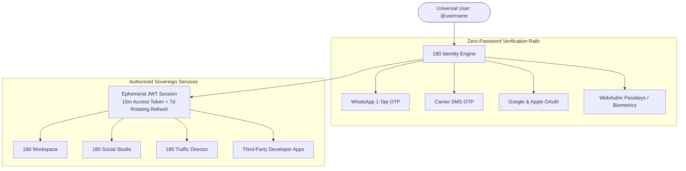
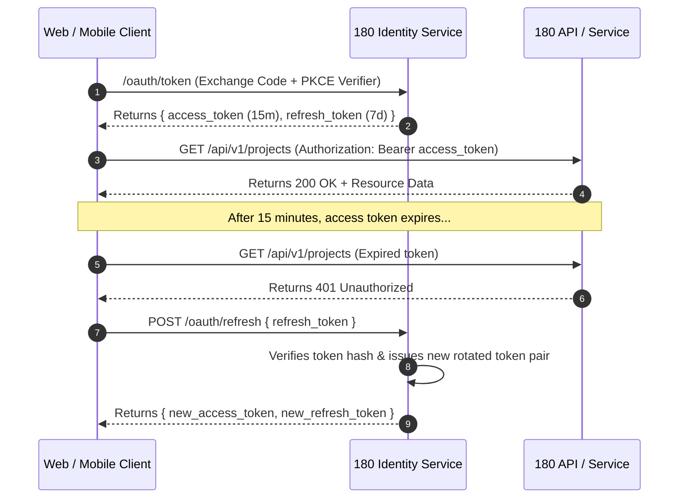

# Universal Account & Single Sign-On

In the 180 ecosystem, identity is not fragmented across multiple registration forms, passwords, and user databases. Every user registers once to receive a **Sovereign Universal Account** anchored by their unique `@username`.

---

## 1. The Sovereign `@username` Model

Traditional web applications rely on email addresses as primary identity anchors. However, email is prone to deliverability issues, spam filters, phishing, and slow verification cycles.

180 introduces the **Sovereign Identity Format**:
- **Identifier**: `@handle` (e.g. `@siddharth`, `@growth_agency`).
- **Global Uniqueness**: Claimed globally across all 180 services.
- **Per-App Identity Isolation**: When a developer integrates 180 Identity, usernames can be mapped into application-specific profiles (`AppUserIdentity`), preventing namespace pollution between enterprise tenants and third-party developer apps.

---

## 2. Zero-Password Authentication Rails

180 completely removes passwords from the authentication loop, eliminating 80% of credential stuffing vulnerabilities and support tickets for forgotten passwords.

### 1. WhatsApp 1-Tap OTP
For mobile and international users, authentication occurs in seconds via official WhatsApp Enterprise Gateways:
1. User enters their phone number or `@username`.
2. A cryptographically secure 6-digit OTP is delivered straight to their verified WhatsApp chat.
3. On mobile devices, 1-tap deep links automatically confirm verification without manual typing.

### 2. WebAuthn Passkeys & Biometrics
Desktop and modern mobile users can log in using Touch ID, Face ID, or Windows Hello hardware security tokens.

### 3. OpenID Connect & OAuth 2.0 PKCE
Third-party enterprise clients integrate with 180 Identity using the industry standard Authorization Code flow with Proof Key for Code Exchange (PKCE).

---

## 3. Token Lifecycle & Cryptographic Security

180 Identity enforces a strict, defense-in-depth token rotation architecture:

### Security Guarantees:
- **15-Minute Short-Lived Access Tokens**: Reduces exposure window in the event of client-side token interception.
- **Automatic Refresh Token Invalidation**: If an old refresh token is reused, 180 Identity detects the replay attack and terminates all active sessions associated with that user family.
- **Centralized Revocation**: Users and administrators can terminate active sessions across all devices instantly with a single click.

---

## 4. Single Sign-On Across the Workspace

When an employee or creator logs into 180:
- Navigating from **180 Workspace** to **180 Social Studio** or **180 Traffic Director** requires zero re-authentication.
- Tenant context (`companyId`) is preserved in workspace claims, enabling instant organization switching without signing out.
- Role-Based Access Control (RBAC) dynamically adjusts permissions based on the active company context.

---

## Next Steps

- Integrate 180 Identity into your own application: **[180 Identity Integration Guide](/docs/products/180-core/180-identity/getting-started)**.
- Review developer SDK specs: **[Global Developer Experience](/docs/05-global-developer-experience)**.
