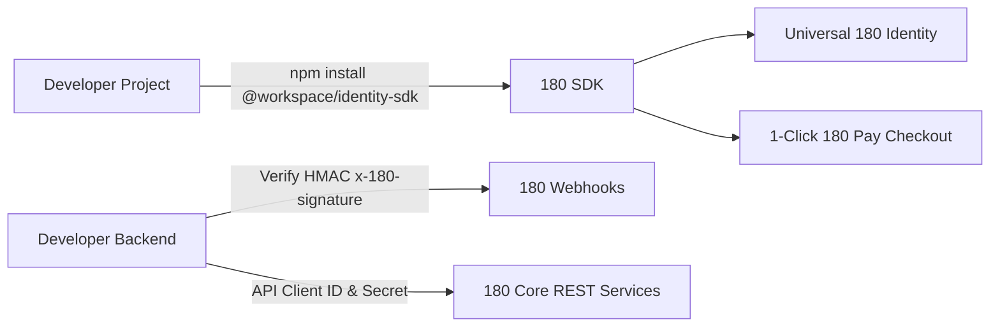

# Developer Ecosystem & SDKs

The **180 Developer Ecosystem** empowers external engineers and internal product teams to build sovereign applications on top of the 180 infrastructure. With official SDKs, typed REST APIs, cryptographically signed webhooks, and pre-packaged AI integration prompts, adding authentication and payments to any project takes less than 5 minutes.



---

## 1. Official SDKs & Packages

### `@workspace/identity-sdk`
The flagship TypeScript / JavaScript SDK providing universal authentication modal launchers, session management, and React hooks:

```bash npm2yarn
npm install @workspace/identity-sdk
```

#### React & Next.js Quickstart
```tsx
import React from 'react';
import { IdentityProvider, useIdentity, LoginButton } from '@workspace/identity-sdk';

export function App() {
  return (
    <IdentityProvider clientId="180_client_live_920489">
      <UserProfile />
    </IdentityProvider>
  );
}

function UserProfile() {
  const { user, isAuthenticated, logout } = useIdentity();

  if (!isAuthenticated) {
    return <LoginButton mode="popup" label="Sign in with 180" />;
  }

  return (
    <div>
      <h3>Welcome, @{user?.username}!</h3>
      <button onClick={logout}>Sign Out</button>
    </div>
  );
}
```

---

## 2. Developer Credentials & Authentication

Every application created in the **[180 Developer Console](https://developers.180workspace.com)** is issued three cryptographic credentials:

| Credential Name | Format / Prefix | Security Scope | Usage |
| :--- | :--- | :--- | :--- |
| **Client ID** | `180_client_...` | Public | Embedded in frontend apps, mobile clients, and login widgets. |
| **Client Secret** | `180_secret_...` | Private (Server-Only) | Authenticates server-to-server REST calls, token exchange, and payment session creation. |
| **Webhook Secret** | `whsec_...` | Private (Server-Only) | Validates incoming HMAC SHA-256 signatures on webhook notifications. |

:::caution Keep Secrets Secure
Never commit your `180_secret_...` or `whsec_...` to public GitHub repositories or include them in client-side bundles. Store them in secure environment variables.
:::

---

## 3. Cryptographically Signed Webhooks

180 emits real-time event notifications for payments, subscription changes, and authentication actions. Every outgoing request includes an `x-180-signature` header:

```typescript
import crypto from 'crypto';

export function verify180Webhook(
  rawBody: string,
  signatureHeader: string,
  webhookSecret: string
): boolean {
  // signatureHeader format: t=1700000000,v1=abc123def456...
  const parts = signatureHeader.split(',');
  const timestamp = parts.find((p) => p.startsWith('t='))?.slice(2);
  const signature = parts.find((p) => p.startsWith('v1='))?.slice(3);

  if (!timestamp || !signature) return false;

  // Protect against replay attacks (5 minute threshold)
  const currentTime = Math.floor(Date.now() / 1000);
  if (Math.abs(currentTime - parseInt(timestamp, 10)) > 300) return false;

  const payload = `${timestamp}.${rawBody}`;
  const expectedSignature = crypto
    .createHmac('sha256', webhookSecret)
    .update(payload)
    .digest('hex');

  return crypto.timingSafeEqual(
    Buffer.from(signature, 'hex'),
    Buffer.from(expectedSignature, 'hex')
  );
}
```

---

## 4. AI-First Developer Integration (Master Prompt)

180 is engineered for AI-assisted software development. Instead of spending hours reading documentation, developers can copy our **1-Click Master AI Integration Prompt** directly into Cursor, Claude, or ChatGPT to generate full-stack integration code instantly.

👉 **[Access the Master AI Integration Prompt](/docs/products/180-core/ai-master-prompt)**

---

## 5. Developer Portals & Useful Links

- **Developer Dashboard**: `https://developers.180workspace.com` (Local: `http://localhost:3008`)
- **Interactive Documentation**: `https://docs.180workspace.com` (Local: `http://localhost:3005`)
- **Core API Endpoint**: `https://services.180workspace.com` (Local: `http://localhost:4003`)
