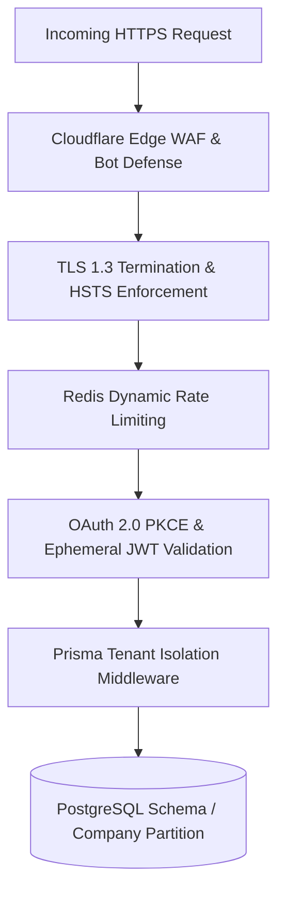
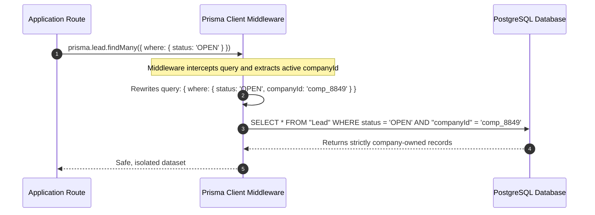

# Security, Multi-Tenancy & Privacy

The **180 Platform** is engineered with a strict **Zero-Trust & Defense-in-Depth** security philosophy. Enterprise organizations trust 180 to host proprietary sales contracts, HR records, creator media archives, and financial transactions. Our architecture guarantees that tenant data remains logically isolated, cryptographically protected, and impervious to cross-tenant contamination.

---

## 1. Dynamic Multi-Tenant Schema Isolation

In multi-tenant cloud applications, the greatest risk is accidental data leakage across tenant boundaries caused by a missing SQL `WHERE companyId = ?` clause.

180 completely neutralizes this attack vector using **Automated ORM-Level Tenant Enforcers**:

### Guarantees:
- **Zero Accidental Leaks**: Developers cannot query tenant tables without satisfying tenant constraints.
- **Foreign Key Cascades with Soft-Deletes**: Deleting a company or project marks records with `deletedAt` timestamps, preserving accounting ledgers while preventing stale data resurrection.
- **Tenant Context Preservation**: Requests across 180 services carry signed tenant context claims that cannot be spoofed by client headers.

---

## 2. Zero-Knowledge Credential Management

When customers or developers configure external payment gateways (Bring Your Own Gateway - BYOG like Razorpay or Stripe) or third-party OAuth apps:

1. **Hardware-Backed AES-256-GCM Encryption**: All third-party secrets, keys, and access tokens are encrypted before touching the database.
2. **Timing-Safe Cryptographic Comparisons**: All token validations, HMAC checks, and password hash comparisons execute using constant-time algorithms (`crypto.timingSafeEqual`) to defeat timing side-channel attacks.
3. **Environment Isolation**: Production database credentials, Redis clusters, and encryption salts are injected at runtime via sovereign secret managers; secrets are strictly forbidden from being checked into source repositories.

---

## 3. Cryptographic Webhook Security

Every webhook emitted by 180 Pay and 180 Identity includes a signature header:
- **Header**: `x-180-signature: t=<timestamp>,v1=<hmac_sha256_hash>`
- **Replay Defense**: Webhooks older than 300 seconds are rejected automatically.
- **Payload Integrity**: Signatures are computed across both the raw timestamp and the raw unparsed JSON string, preventing parameter tampering.

---

## 4. Edge Threat Defense & Rate Limiting

- **DDoS & Scraping Mitigation**: Cloudflare Edge Workers and Web Application Firewalls (WAF) inspect requests at the edge, blocking bad bots and high-volume crawlers before reaching internal origin servers.
- **Leaky Bucket Rate Limiting**: Redis-backed distributed rate limiters throttle excessive requests per IP and per API key, preventing brute-force and resource-exhaustion attacks.
- **Role-Based Access Control (RBAC)**: Fine-grained permissions (`OWNER`, `ADMIN`, `MANAGER`, `MEMBER`, `VIEWER`) govern every API endpoint and user action.

---

## 5. Vulnerability Disclosure & Compliance

180 maintains a continuous audit and stabilization process:
- All packages undergo automated dependency vulnerability scans.
- Static analysis and strict TypeScript compilation are enforced on every pull request.
- For security vulnerabilities, reach out to our dedicated team at `security@180workspace.com`.
