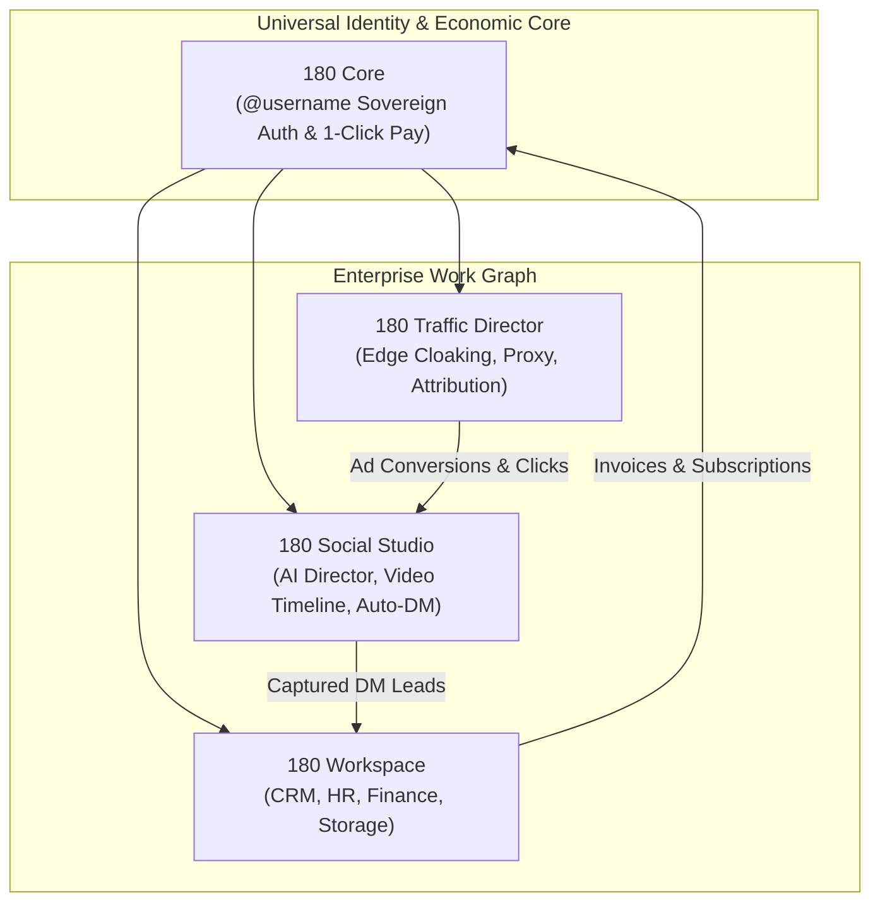
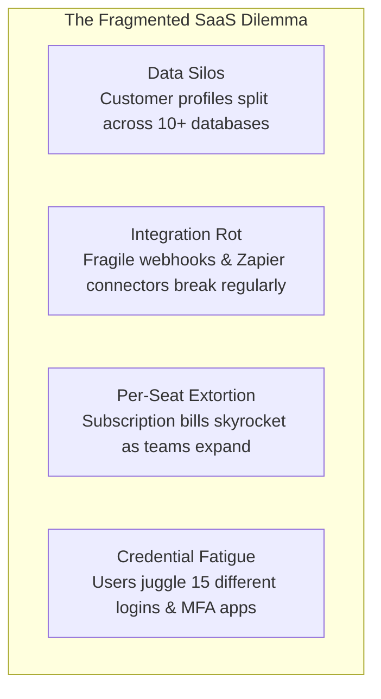
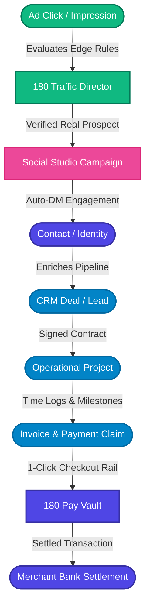
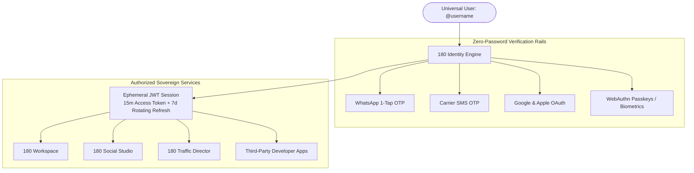
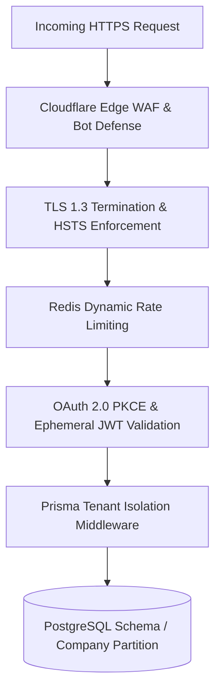

# 180 Platform Ecosystem Overview

Welcome to the **180 Platform** documentation. 180 is a sovereign, unified business and media operating system engineered to eliminate SaaS tool fragmentation, arbitrary per-seat pricing, and repetitive operational overhead for modern companies, agencies, and high-velocity creators.



---

## 1. Product Vision & Purpose

At **180**, we believe that modern businesses, creative studios, and software builders should own their digital sovereignty. The last decade of cloud software forced enterprises into an expensive, fragmented subscription trap where critical operational data is leased from dozens of disconnected platforms.



### The 4 Defects of Traditional SaaS
1. **Data Silos & Disconnected Context**: When an ad converts on Meta, the click intelligence lives in an ads dashboard, the lead record sits in HubSpot, the conversation unfolds in ManyChat, the project tasks land in Asana, and the payment settles in Stripe. No single team member has an unfragmented view of the customer lifecycle.
2. **Integration Rot & Synchronization Latency**: Connecting disjointed apps requires thousands of brittle webhook triggers, external middleware services, and ongoing maintenance. A single schema change in one external API breaks downstream workflows silently.
3. **Per-Seat Pricing Penalties**: Traditional SaaS companies monetize headcount rather than compute consumption. Adding a contract designer, a temporary customer support agent, or an external accountant incurs recurring per-seat fees that penalize organizational agility.
4. **Vulnerable Identity Surface**: Every third-party SaaS tool introduced into a business introduces a new attack vector, credential repository, and compliance liability.

### The 180 Solution: Sovereign Unified Operations
180 replaces this patchwork with an interconnected **Sovereign Work Graph**:
- **Unified Work Graph**: An event triggered in 180 Traffic Director immediately mutates state in 180 Social Studio and surfaces as an actionable deal in 180 Workspace CRM.
- **Sovereign Identity Model (`@username`)**: Every user owns a single sovereign identity. Instant authentication via WhatsApp 1-Tap OTP or OAuth 2.0 PKCE without password fatigue.
- **True Data Sovereignty**: Businesses own their database records. Dynamic tenant schema isolation ensures company records are never co-mingled or used to train external proprietary models without explicit consent.
- **Fair Resource-Based Pricing**: Clear, predictable platform tiers and compute-based usage replace arbitrary per-seat penalties.

---

## 2. The Sovereign Work Graph Architecture

The **180 Work Graph** is the foundational event-driven relational fabric connecting all 180 product lines. Rather than treating customer records, communication threads, ad attribution metrics, and financial ledgers as isolated relational tables, the Work Graph models operational entities as vertices connected by directed, event-driven edges.



### Graph Topology: Core Node Archetypes

| Node Archetype | Originating Product | Description |
| :--- | :--- | :--- |
| **Identity Node** (`AppUserIdentity`) | 180 Identity | Sovereign individual user identified by `@username`, mobile number, or OAuth identity. |
| **Company Node** (`Company`) | 180 Workspace | Sovereign business organization with isolated schema and RBAC policy. |
| **Traffic Node** (`TrafficRule`, `EvaluationLog`) | 180 Traffic Director | Real-time edge routing filter, cloaking verdict, and ad tracking macro state. |
| **Media Node** (`MediaProject`, `AutoDmTrigger`) | 180 Social Studio | Video assets, script drafts, scheduled posts, and keyword DM dispatchers. |
| **Commercial Node** (`Lead`, `Deal`, `Contact`) | 180 Workspace CRM | Sales pipeline stages, customer conversation histories, and value forecasts. |
| **Financial Node** (`Invoice`, `PaymentSession`) | 180 Pay & Workspace | Cryptographically verified billing contracts, subscription schedules, and payouts. |

### Autonomous Cross-Product Event Bus
Data synchronization across products does not rely on external webhooks or scheduled polling. Instead, 180 utilizes an internal, zero-latency event bus with Redis Pub/Sub and transactional outbox persistence in PostgreSQL:

```mermaid
sequenceDiagram
    autonumber
    actor Visitor as Prospect / Ad Click
    participant TD as 180 Traffic Director
    participant SS as 180 Social Studio
    participant WS as 180 Workspace CRM
    participant Pay as 180 Pay Core

    Visitor->>TD: Clicks High-Velocity Ad Campaign
    TD->>TD: Sub-1ms Edge Inspection (Filters Bots/Spies)
    TD->>SS: Routes to Instagram/TikTok Lead Magnet
    Visitor->>SS: Comments keyword "GROWTH"
    SS->>Visitor: Auto-DM delivers lead magnet with 1-Click link
    SS->>WS: Creates qualified Lead in CRM Deals Pipeline
    WS->>WS: Sales team closes deal
    WS->>Pay: Issues dynamic Invoice with 1-Tap checkout link
    Pay-->>WS: Webhook confirms settlement; funds routed
```

---

## 3. Universal Account & Identity

Every user in the 180 ecosystem registers once to receive a **Sovereign Universal Account** anchored by their unique `@username`.



### Key Identity Features
- **Sovereign `@username` Format**: Globally claimed across all 180 services, eliminating email deliverability issues.
- **Zero-Password Verification**: Instant authentication via WhatsApp 1-Tap OTP, SMS verification, or WebAuthn biometrics.
- **Ephemeral Token Architecture**: 15-minute short-lived access tokens paired with 7-day rotating refresh tokens and automatic reuse detection.
- **Single Sign-On (SSO)**: Moving between 180 Workspace, 180 Social Studio, and 180 Traffic Director requires zero re-authentication.

---

## 4. Global Developer Experience & SDKs

The **180 Developer Ecosystem** empowers engineers to integrate sovereign authentication and 1-Click payments with minimal code:

### `@workspace/identity-sdk` Quickstart

```tsx
import React from 'react';
import { IdentityProvider, useIdentity, LoginButton } from '@workspace/identity-sdk';

export function App() {
  return (
    <IdentityProvider clientId="180_client_live_920489">
      <UserProfile />
    </IdentityProvider>
  );
}

function UserProfile() {
  const { user, isAuthenticated, logout } = useIdentity();

  if (!isAuthenticated) {
    return <LoginButton mode="popup" label="Sign in with 180" />;
  }

  return (
    <div>
      <h3>Welcome, @{user?.username}!</h3>
      <button onClick={logout}>Sign Out</button>
    </div>
  );
}
```

### Cryptographically Signed Webhooks
All asynchronous events include an `x-180-signature` header with HMAC SHA-256 signatures and timestamp verification to protect against replay attacks.

---

## 5. Security, Multi-Tenancy & Trust

180 enforces a strict **Zero-Trust & Defense-in-Depth** security architecture:



### Architectural Security Guarantees
1. **Dynamic Multi-Tenant Schema Isolation**: Prisma ORM middleware automatically injects `companyId` boundaries into all database operations, mathematically preventing cross-tenant data leaks.
2. **Zero-Knowledge Credentialing**: External payment keys (BYOG Razorpay / Stripe credentials) and OAuth secrets are AES-256-GCM encrypted at rest. Constant-time comparisons (`crypto.timingSafeEqual`) prevent timing side-channel attacks.
3. **Edge Threat Defense**: Cloudflare Edge Workers and distributed Redis rate limiters block malicious scraping bots and DDoS traffic before requests touch internal application servers.

---

## 6. The 4 Core Product Lines

Explore the dedicated documentation suites for each product line:

| Product Line | Target Audience | Primary Capabilities |
| :--- | :--- | :--- |
| **[180 Workspace](/docs/products/180-workspace/overview)** | Modern Companies & Agencies | Full-suite CRM, HR team directory, multi-currency invoicing, enterprise cloud storage, and multi-company RBAC. |
| **[180 Social Studio](/docs/products/180-social-studio/overview)** | Content Creators, Media Brands | AI script director, voice-synced teleprompter, 60fps multi-track video timeline, 1-click multi-platform publishing, and viral Auto-DM lead capture. |
| **[180 Core](/docs/products/180-core/overview)** | Developers & SaaS Builders | Zero-password authentication via WhatsApp 1-Tap OTP, universal single sign-on, and 1-Click bottom-sheet checkout with BYOG support. |
| **[180 Traffic Director](/docs/products/180-traffic-director/overview)** | Media Buyers, Performance Marketers | Sub-millisecond Cloudflare edge cloaking, threat intelligence bot defense, dynamic macro interpolation, and ad attribution postbacks. |
