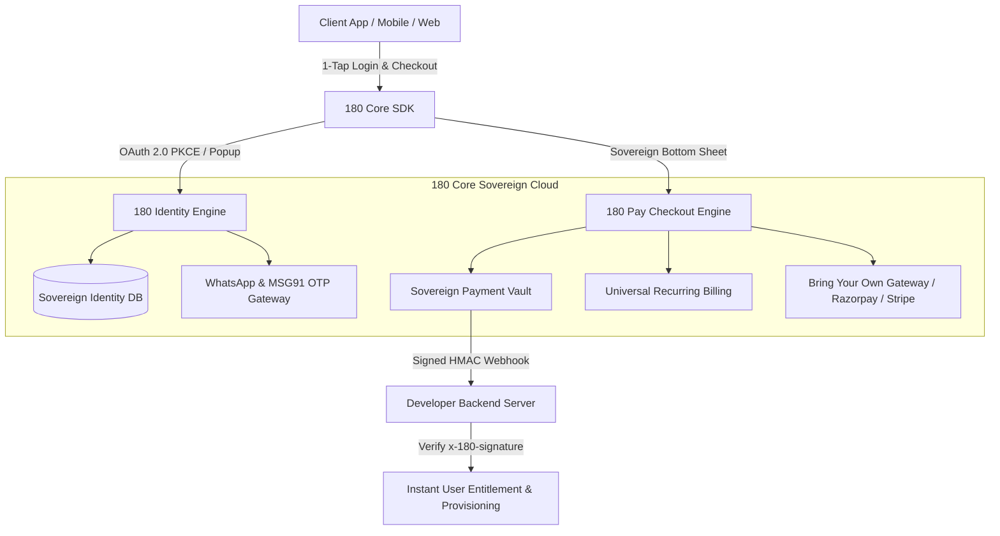

# 180 Core Platform Architecture

Welcome to the **180 Core Platform** documentation. 180 Core provides developers with a sovereign, zero-friction infrastructure layer combining **Universal Authentication (180 Identity)** and **1-Click Sovereign Payments (180 Pay)** into any web, mobile, or desktop application.

---

## The Dual Pillars of 180 Core

### 1. 180 Identity (Universal Sovereign Authentication)
- **Universal Single Sign-On**: Authenticate users across web and mobile using OAuth 2.0 + OpenID Connect with full PKCE protection.
- **WhatsApp 1-Tap OTP**: Zero-password, zero-friction authentication powered by instant WhatsApp and SMS verification.
- **Per-App Identity Isolation**: Usernames are scoped strictly per application (`AppUserIdentity`), guaranteeing that username collisions never spill between different developer apps.
- **15-Minute Ephemeral Access Tokens & 7-Day Rotating Refresh Tokens**: High-security token lifecycle preventing persistent breach exposure.
- **Central User Revocation**: Developers can immediately revoke active sessions from their console or via server-to-server REST API.

### 2. 180 Pay (1-Click Sovereign Payments & Subscriptions)
- **1-Click Bottom Sheet & Popup Checkout**: Ultra-fast UPI, Sovereign Wallet, Credit Card, and Netbanking modal checkout that eliminates 90% of gateway redirection drop-offs.
- **Universal Recurring Subscriptions**: Built-in monthly and annual recurring subscription management with automated dunning cycles, trial periods, and grace windows.
- **Embeddable Pricing Tables**: Plug-and-play Web Component (`<one-eighty-pricing-table>`), React component, and headless JSON API.
- **Bring Your Own Gateway (BYOG)**: Developers can use 180 Platform default rails or connect their own Razorpay / Stripe credentials directly.
- **Dynamic Geo-Pricing**: Automated IP-based country detection that presents local currencies (INR, USD, EUR, GBP, BRL) with custom purchasing power parity (PPP) discounts.
- **HMAC SHA-256 Webhook Verification**: High-security, cryptographically signed webhook notifications with timestamp-based replay attack defense.

---

## 3 API Credentials Model

Every developer application in 180 Workspace receives three cryptographic keys:

| Key Name | Prefix | Visibility | Purpose |
| :--- | :--- | :--- | :--- |
| **Client ID** | `180_client_...` | Public | Identifies your application in SDKs, login URLs, and checkout sheets. |
| **Client Secret** | `180_secret_...` | Server-Only | Authorizes backend token exchanges and server-to-server checkout session creation. |
| **Webhook Secret** | `whsec_...` | Server-Only | Verifies HMAC SHA-256 signatures on incoming webhook notifications (`x-180-signature`). |

:::caution Security First
Never expose your `CLIENT_SECRET` or `WEBHOOK_SECRET` in frontend client code, git repositories, or mobile bundles. Store them in secure environment variables (`.env`).
:::

---

## Developer Ecosystem Ports & Endpoints

| Service | Environment | URL |
| :--- | :--- | :--- |
| **Developer Console** | Production | `https://developers.180workspace.com` |
| **Developer Console** | Local Dev | `http://localhost:3008` |
| **180 Core Backend API** | Production | `https://services.180workspace.com` |
| **180 Core Backend API** | Local Dev | `http://localhost:4003` |
| **Universal Identity UI** | Production | `https://auth.180workspace.com` |
| **Universal Identity UI** | Local Dev | `http://localhost:3009` |
| **Documentation Portal** | Production | `https://docs.180workspace.com` |
| **Documentation Portal** | Local Dev | `http://localhost:3005` |

---

## Next Steps

- **[Master AI Integration Prompt](/docs/core/ai-master-prompt)**: Copy a ready-to-paste AI prompt for ChatGPT/Claude/Cursor to integrate 180 Identity and 180 Pay in 2 minutes.
- **[180 Identity Integration](/docs/core/identity/getting-started)**: Step-by-step setup for Universal Login & WhatsApp 1-Tap.
- **[180 Pay Integration](/docs/core/pay/getting-started)**: Step-by-step setup for 1-Click Payments & Recurring Subscriptions.
- **[Webhook Verification Guide](/docs/core/pay/webhook-integration)**: Production code examples for verifying HMAC signatures in Node.js, Next.js, and Python.
