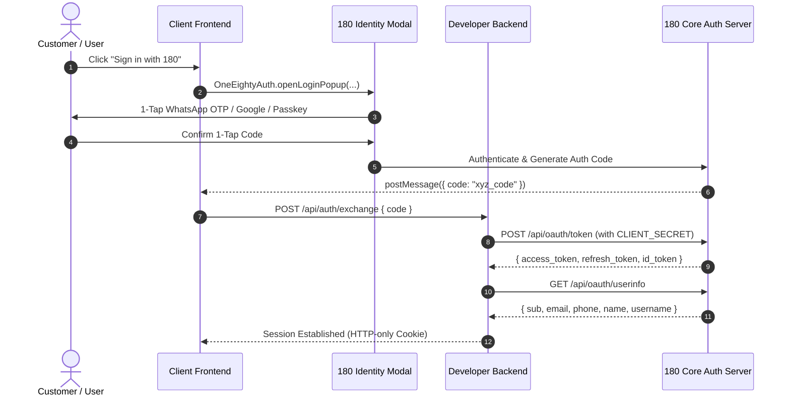

# 180 Identity Quickstart

Integrate universal, zero-friction authentication into any web application in under 35 lines of code.



---

## 1. Prerequisites

1. Create a Project in the [180 Developer Portal](https://developers.180workspace.com).
2. Note your **Client ID** (`180_client_...`) and **Client Secret** (`180_secret_...`).
3. Add your Redirect URI in Developer Portal Settings:
   - For local development: `http://localhost:3000/callback` (or your local port).
   - For production: `https://yourapp.com/callback`.

---

## 2. Client-Side Integration (React / Next.js)

Install the SDK:
```bash
npm install @workspace/identity-sdk
```

Add the 1-click popup login button:

```tsx
import { OneEightyAuth } from '@workspace/identity-sdk';

export function LoginButton() {
  const onLogin = () => {
    OneEightyAuth.openLoginPopup({
      clientId: 'YOUR_CLIENT_ID',
      redirectUri: `${window.location.origin}/callback`,
      scope: 'openid identity:read identity:email identity:phone',
      uxMode: 'popup', // 'popup' | 'bottom_sheet' | 'redirect'
      onSuccess: async ({ code }) => {
        // Send authorization code to your backend
        await fetch('/api/auth/exchange', {
          method: 'POST',
          headers: { 'Content-Type': 'application/json' },
          body: JSON.stringify({ code }),
        });
        window.location.reload();
      },
      onError: (err) => console.error('Login error:', err),
    });
  };

  return <button onClick={onLogin}>Sign in with 180</button>;
}
```

---

## 3. Server-Side Token Exchange

When the frontend receives the authorization code, exchange it securely on your backend using your `CLIENT_SECRET`:

```ts
// Node.js / Express or Next.js Route Handler
const tokenResponse = await fetch('https://services.180workspace.com/api/oauth/token', {
  method: 'POST',
  headers: { 'Content-Type': 'application/json' },
  body: JSON.stringify({
    grant_type: 'authorization_code',
    code: req.body.code,
    client_id: process.env.180_CLIENT_ID,
    client_secret: process.env.180_CLIENT_SECRET,
    redirect_uri: 'http://localhost:3000/callback',
  }),
});

const { access_token, refresh_token } = await tokenResponse.json();

// Fetch verified user profile
const userResponse = await fetch('https://services.180workspace.com/api/oauth/userinfo', {
  headers: { Authorization: `Bearer ${access_token}` },
});

const user = await userResponse.json();
console.log('Authenticated User:', user);
// user: { id, email, phone, name, username, isEmailVerified, isPhoneVerified }
```

---

## 4. Scopes Reference

| Scope | Description |
| :--- | :--- |
| `openid` | Standard OIDC identifier (`sub`). Required for authentication. |
| `identity:read` | Basic public profile information: name, avatar, bio. |
| `identity:email` | Verified email address. |
| `identity:phone` | Verified telephone number (WhatsApp / SMS verified). |

Next, explore the [Universal Login Flow](./universal-login-flow) to customize popup vs bottom-sheet modes.
