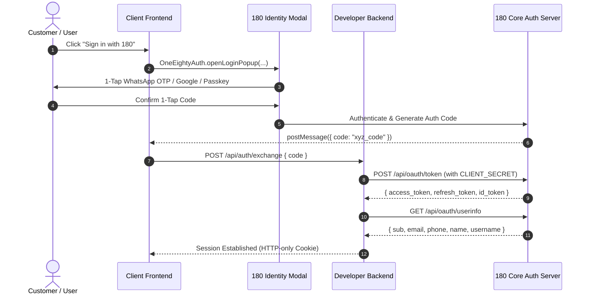

# 180 Identity Quickstart

Integrate universal, zero-friction authentication into any web application in under 35 lines of code.



---

## 1. Prerequisites

1. Create a Project in the [180 Developer Portal](https://developers.180workspace.com).
2. Note your **Client ID** (`180_client_...`) and **Client Secret** (`180_secret_...`).
3. Add your Redirect URI in Developer Portal Settings:
   - For local development: `http://localhost:3000/callback` (or your local port).
   - For production: `https://yourapp.com/callback`.

---

## 2. Client-Side Integration

You can integrate 180 Identity using either the zero-dependency CDN script (recommended for all frameworks) or the official npm package.

### Option A: Next.js App Router & React (CDN / Dynamic Loader)

Create a lightweight helper file `lib/180-identity.ts` in your app:

```typescript
'use client';

/**
 * Universal 180 Identity Loader for React & Next.js App Router
 */
export async function init180Sdk(): Promise<any> {
  if (typeof window === 'undefined') return null;

  // 1. Check existing global instances
  const existing =
    (window as any).OneEightyIdentity ||
    (window as any).OneEightyAuth ||
    (window as any).OneEighty?.auth;
  if (existing) return existing;

  // 2. Inject official CDN script if not present
  if (!document.querySelector('script[src*="180-core-sdk.js"]')) {
    const s = document.createElement('script');
    s.src = 'https://auth.180workspace.com/sdk/v1/180-core-sdk.js';
    s.async = true;
    document.body.appendChild(s);
  }

  // 3. Poll for readiness
  const timeout = Date.now() + 4000;
  while (Date.now() < timeout) {
    const inst =
      (window as any).OneEightyIdentity ||
      (window as any).OneEightyAuth ||
      (window as any).OneEighty?.auth;
    if (inst) return inst;
    await new Promise((r) => setTimeout(r, 60));
  }

  throw new Error('[180 Identity] 180 Core SDK failed to load within 4 seconds');
}

export async function loginWith180(
  clientId: string,
  options: {
    uxMode?: 'bottom_sheet' | 'popup' | 'modal' | 'fullscreen';
    scope?: string;
    onSuccess: (res: { code: string; token?: string; user?: any }) => void;
    onError?: (err: Error) => void;
    onCancel?: () => void;
  }
) {
  const auth = await init180Sdk();
  return auth.signIn({
    clientId,
    uxMode: options.uxMode || 'bottom_sheet',
    scope: options.scope || 'openid identity:read identity:email',
    onSuccess: options.onSuccess,
    onError: options.onError,
    onCancel: options.onCancel,
  });
}
```

Now in your login component (`app/(auth)/login/page.tsx`):

```tsx
'use client';

import { loginWith180 } from '@/lib/180-identity';

export function LoginButton() {
  const handleLogin = () => {
    loginWith180(process.env.NEXT_PUBLIC_180_CLIENT_ID || '180_client_...', {
      uxMode: 'bottom_sheet', // Responsive bottom-sheet on mobile, sleek glass modal on desktop
      onSuccess: async (data) => {
        // Exchange code with your backend
        await fetch('/api/auth/exchange', {
          method: 'POST',
          headers: { 'Content-Type': 'application/json' },
          body: JSON.stringify({ code: data.code }),
        });
        window.location.href = '/dashboard';
      },
      onError: (err) => console.error('180 Login error:', err),
    });
  };

  return (
    <button onClick={handleLogin} className="btn-180-login">
      Sign in with 180 Profile
    </button>
  );
}
```

:::tip Localhost Testing
The 180 Core SDK automatically detects third-party integrators testing on `http://localhost:3000` or `http://localhost:3101` and seamlessly connects to the live 180 Sovereign Cloud (`https://profile.180workspace.com`). You do **not** need to run local 180 backend services on your machine.
:::

---

### Option B: Vanilla HTML / Script Tag

Add the script tag to your `<head>` or before `</body>`:

```html
<script src="https://auth.180workspace.com/sdk/v1/180-core-sdk.js" async></script>

<button id="login-btn">Sign in with 180</button>

<script>
  document.getElementById('login-btn').addEventListener('click', function () {
    // Both window.OneEightyAuth and window.OneEightyIdentity are supported!
    window.OneEightyAuth.signIn({
      clientId: 'YOUR_CLIENT_ID',
      uxMode: 'bottom_sheet',
      scope: 'openid identity:read identity:email',
      onSuccess: function (data) {
        console.log('Received auth code:', data.code);
        console.log('User profile:', data.user);
      },
      onError: function (err) {
        console.error('Login error:', err.message, err.hint);
      }
    });
  });
</script>
```

---

## 3. Server-Side Token Exchange

When your frontend receives the authorization code (`data.code`), exchange it securely on your backend using your `CLIENT_SECRET` via RFC 6749 OAuth:

```ts
// Node.js / Express or Next.js Route Handler (app/api/auth/exchange/route.ts)
import { NextResponse } from 'next/server';

export async function POST(req: Request) {
  const { code } = await req.json();

  // 1. Exchange authorization code for access token & ID token
  const tokenResponse = await fetch('https://services.180workspace.com/api/oauth/token', {
    method: 'POST',
    headers: { 'Content-Type': 'application/json' },
    body: JSON.stringify({
      grant_type: 'authorization_code',
      code,
      client_id: process.env.ONE_EIGHTY_CLIENT_ID,
      client_secret: process.env.ONE_EIGHTY_CLIENT_SECRET,
      redirect_uri: process.env.NEXT_PUBLIC_APP_URL + '/callback',
    }),
  });

  if (!tokenResponse.ok) {
    const errorBody = await tokenResponse.json();
    return NextResponse.json({ error: 'Token exchange failed', details: errorBody }, { status: 400 });
  }

  const { access_token, id_token, user } = await tokenResponse.json();

  // 2. Fetch or verify user profile via OIDC UserInfo
  const userResponse = await fetch('https://services.180workspace.com/api/oauth/userinfo', {
    headers: { Authorization: `Bearer ${access_token}` },
  });
  const verifiedUser = await userResponse.json();

  // 3. Set your own session cookie or JWT
  const res = NextResponse.json({ success: true, user: verifiedUser });
  res.cookies.set('session', access_token, { httpOnly: true, secure: true });
  return res;
}
```

---

## 4. Scopes Reference

| Scope | Description |
| :--- | :--- |
| `openid` | Standard OIDC identifier (`sub`). Required for authentication. |
| `identity:read` | Basic public profile information: name, avatar, headline. |
| `identity:email` | Verified email address. |
| `identity:phone` | Verified telephone number (WhatsApp / SMS verified). |

Next, explore the [SDK Reference](./sdk-reference) for the authoritative Domain Architecture map, error code diagnostics, and advanced configuration.

