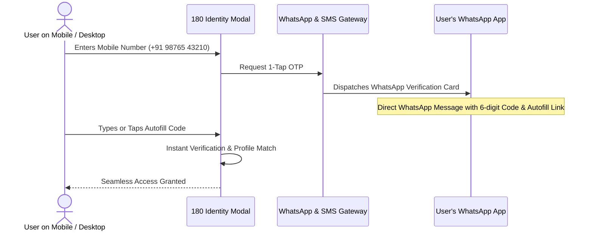

# WhatsApp 1-Tap OTP Authentication

Passwords are the single largest source of user drop-off during onboarding. 180 Identity incorporates native **WhatsApp 1-Tap OTP verification**, allowing users to sign in instantly with their verified mobile phone number.



---

## Key Benefits for Developers

1. **Zero Configuration**: Developers do not need to negotiate telecom carrier agreements, buy Twilio credits, or configure WhatsApp Business Templates. 180 Core manages all carrier compliance and gateway routing automatically.
2. **Instant Verified Phone Number**: When requesting the `identity:phone` scope, your backend receives a cryptographically verified `phone` field with `isPhoneVerified: true`.
3. **Smart Fallback**: If a user does not have WhatsApp active on their number, the system automatically falls back to High-Priority Transactional SMS OTP with zero latency penalty.
4. **Pre-Filled User Consent**: Users who have previously signed into any 180 ecosystem application authenticate in a single tap without re-entering their details.

---

## Requesting Phone Scope

To request verified phone numbers during login, include `identity:phone` in your scope string:

```ts
OneEightyAuth.openLoginPopup({
  clientId: 'YOUR_CLIENT_ID',
  redirectUri: 'https://yourapp.com/callback',
  scope: 'openid identity:read identity:email identity:phone',
  onSuccess: async ({ code }) => {
    // Exchange token on backend
  },
});
```

Backend `userinfo` response will contain:
```json
{
  "sub": "usr_9f82b1c2-3e4a-4d5f-9a1b-8c7d6e5f4a3b",
  "name": "Arjun Sharma",
  "username": "arjun_builds",
  "email": "arjun@example.com",
  "phone": "+919876543210",
  "isPhoneVerified": true,
  "isEmailVerified": true
}
```
