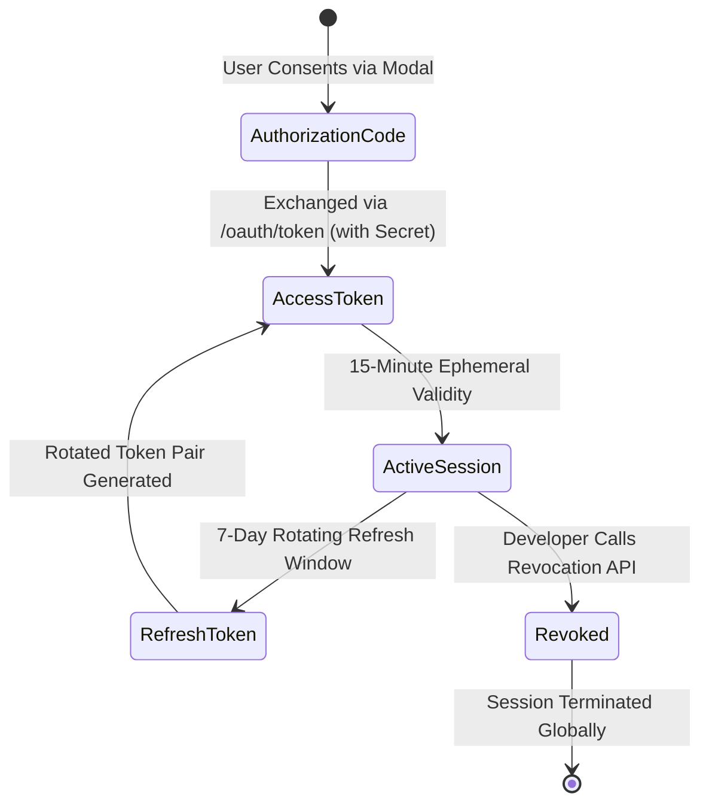

# Token Lifecycle & Session Revocation

180 Identity enforces a strict security posture utilizing short-lived access tokens combined with rotating refresh tokens to mitigate credential leakage.



---

## 1. Token Lifetimes & Properties

| Token Type | Lifetime | Storage Recommendation | Purpose |
| :--- | :--- | :--- | :--- |
| **Authorization Code** | 5 Minutes (Single-Use) | Transient memory | Used strictly to complete the OAuth 2.0 exchange. Immediately invalidated upon use. |
| **Access Token** | **15 Minutes** (900 seconds) | In-memory or encrypted HTTP-only cookie | Bearer token passed in `Authorization: Bearer <token>` to access resources and userinfo. |
| **Refresh Token** | **7 Days** | Secure, HTTP-only server cookie or backend DB | Exchanges for a new access token and new rotated refresh token without requiring re-login. |
| **ID Token** | 15 Minutes | In-memory / decoded locally | Standard OpenID Connect signed JWT containing user claims and signature. |

---

## 2. Refreshing an Expired Access Token

When your application receives a `401 Unauthorized` or detects that the 15-minute access token has expired, exchange the refresh token:

```ts
const refreshResponse = await fetch('https://services.180workspace.com/api/oauth/token', {
  method: 'POST',
  headers: { 'Content-Type': 'application/json' },
  body: JSON.stringify({
    grant_type: 'refresh_token',
    refresh_token: savedRefreshToken,
    client_id: process.env.180_CLIENT_ID,
    client_secret: process.env.180_CLIENT_SECRET,
  }),
});

const data = await refreshResponse.json();
// data: { access_token, refresh_token, token_type: "Bearer", expires_in: 900 }
```

:::warning Refresh Token Rotation
180 Identity enforces **Refresh Token Rotation (RTR)**. Every time you use a refresh token, it is invalidated and replaced by a brand-new refresh token. Always update your database or session store with the newly returned `refresh_token`.
:::

---

## 3. Instant User Session Revocation API

Developers can instantly terminate a compromised user session directly from their own backend server:

### Endpoint:
```http
POST /api/v1/identity/developer/apps/:appId/revoke-user
Host: services.180workspace.com
Authorization: Bearer <developer_token_or_client_secret_auth>
Content-Type: application/json

{
  "userId": "usr_9f82b1c2-3e4a-4d5f-9a1b-8c7d6e5f4a3b"
}
```

### Response:
```json
{
  "success": true,
  "message": "All active sessions and refresh tokens for user revoked successfully."
}
```

When revoked:
1. All active refresh tokens belonging to that user for your application are immediately deleted.
2. The user will fail token refresh and must re-authenticate.
3. The event appears instantly in your Developer Console under **Auth Logs**.
