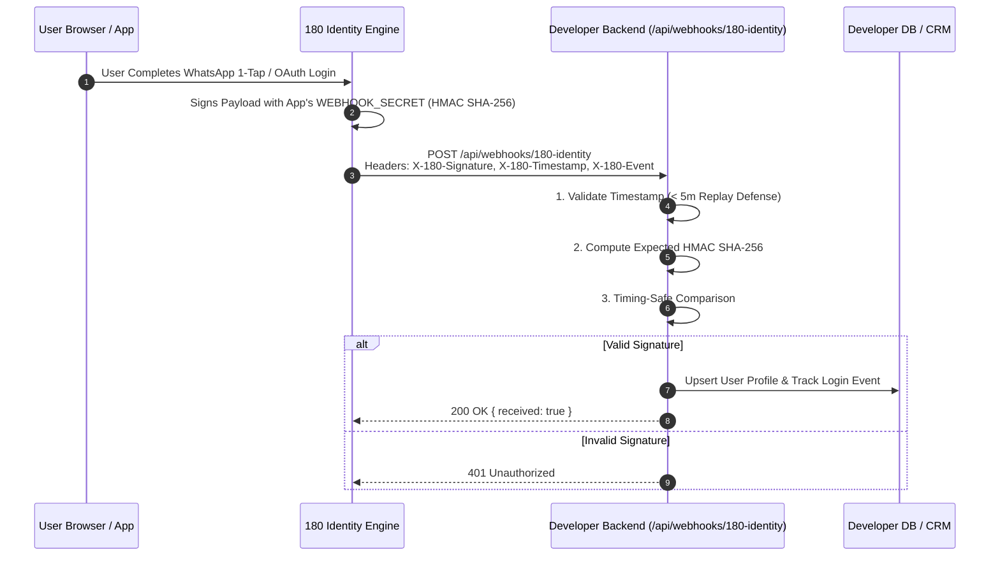

# 180 Identity Webhooks & Real-Time Auth Events

180 Identity delivers instantaneous, server-to-server HTTP POST notifications to your backend whenever authentication events occur. This ensures your user database, analytics pipelines, and CRM systems stay perfectly synchronized with zero polling latency.



---

## 1. Identity Event Catalog

| Event Name | Trigger Condition | Key Payload Fields |
| :--- | :--- | :--- |
| **`identity.user.signup`** | A new user signs in for the first time with an isolated username and verified credentials. | `userId`, `username`, `email`, `phone`, `authMethod`, `createdAt` |
| **`identity.user.authenticated`** | An existing user completes login (OAuth, WhatsApp OTP, or Passkey). | `userId`, `sessionId`, `ipAddress`, `userAgent`, `timestamp` |
| **`identity.user.phone_verified`** | User successfully proves WhatsApp / SMS possession with zero friction OTP. | `userId`, `phone`, `verifiedAt`, `channel` |
| **`identity.session.revoked`** | A user session or refresh token is revoked via Developer Console or user logout. | `userId`, `sessionId`, `reason`, `revokedAt` |
| **`identity.user.deleted`** | User requests GDPR erasure or account deletion across your platform. | `userId`, `requestedAt`, `gracePeriodDays` |

---

## 2. Event Payload Schema

```json
{
  "id": "evt_id_8f1a3e9c4b2d",
  "event": "identity.user.signup",
  "appId": "7697a348-7550-4229-9595-08ba67aa9755",
  "timestamp": 1728135600,
  "data": {
    "userId": "usr_c394a1b0-9f5b-4b2a-8d1e-456789abcdef",
    "username": "alex.chen_e9a1",
    "email": "alex.chen@example.com",
    "phone": "+919876543210",
    "phoneVerified": true,
    "authMethod": "whatsapp_otp",
    "ipAddress": "203.0.113.195",
    "createdAt": "2026-10-05T13:40:00.000Z"
  }
}
```

---

## 3. Cryptographic HMAC Verification

Every webhook notification includes security headers:
- `X-180-Signature`: Hex-encoded HMAC-SHA256 signature calculated over `${timestamp}.${rawBody}`.
- `X-180-Timestamp`: Unix epoch timestamp in seconds.
- `X-180-Event`: The event type string.

### Next.js (App Router: `app/api/webhooks/180-identity/route.ts`)

```ts
import { NextResponse } from 'next/server';
import crypto from 'crypto';

export async function POST(req: Request) {
  try {
    // 1. Extract raw unparsed body
    const rawBody = await req.text();
    const signature = req.headers.get('x-180-signature') || '';
    const timestamp = req.headers.get('x-180-timestamp') || '';
    const webhookSecret = process.env.ONE_EIGHTY_WEBHOOK_SECRET;

    if (!signature || !timestamp || !webhookSecret) {
      return NextResponse.json({ error: 'Missing security headers or secret' }, { status: 400 });
    }

    // 2. Replay attack defense (reject clock drift > 5 minutes)
    const currentTime = Math.floor(Date.now() / 1000);
    if (Math.abs(currentTime - parseInt(timestamp, 10)) > 300) {
      return NextResponse.json({ error: 'Timestamp expired (possible replay attack)' }, { status: 401 });
    }

    // 3. Compute expected HMAC SHA-256 signature
    const signaturePayload = `${timestamp}.${rawBody}`;
    const expectedSignature = crypto
      .createHmac('sha256', webhookSecret)
      .update(signaturePayload)
      .digest('hex');

    // 4. Timing-safe comparison
    const sigBuffer = Buffer.from(signature, 'hex');
    const expectedBuffer = Buffer.from(expectedSignature, 'hex');

    if (sigBuffer.length !== expectedBuffer.length || !crypto.timingSafeEqual(sigBuffer, expectedBuffer)) {
      return NextResponse.json({ error: 'Cryptographic signature mismatch' }, { status: 401 });
    }

    // 5. Safe to process event
    const event = JSON.parse(rawBody);

    switch (event.event) {
      case 'identity.user.signup':
        await handleUserSignup(event.data);
        break;
      case 'identity.user.authenticated':
        await handleUserLogin(event.data);
        break;
      case 'identity.session.revoked':
        await handleSessionRevocation(event.data);
        break;
    }

    return NextResponse.json({ received: true });
  } catch (err: any) {
    return NextResponse.json({ error: err.message }, { status: 500 });
  }
}

async function handleUserSignup(data: any) {
  // Sync new user with internal database or CRM
  console.log('New user onboarded via 180 Identity:', data.userId, data.username);
}

async function handleUserLogin(data: any) {
  // Track login analytics or update lastLoginAt
}

async function handleSessionRevocation(data: any) {
  // Invalidate local cookies or sessions
}
```

### Node.js / Express

```ts
import express from 'express';
import crypto from 'crypto';

const app = express();

// CRITICAL: Webhook endpoints require the raw request body
app.post(
  '/api/webhooks/180-identity',
  express.raw({ type: 'application/json' }),
  (req, res) => {
    const rawBody = req.body.toString('utf-8');
    const signature = req.headers['x-180-signature'] as string;
    const timestamp = req.headers['x-180-timestamp'] as string;
    const webhookSecret = process.env.ONE_EIGHTY_WEBHOOK_SECRET!;

    const payload = `${timestamp}.${rawBody}`;
    const expected = crypto.createHmac('sha256', webhookSecret).update(payload).digest('hex');

    if (!crypto.timingSafeEqual(Buffer.from(signature), Buffer.from(expected))) {
      return res.status(401).send('Invalid signature');
    }

    const event = JSON.parse(rawBody);
    console.log('Received authentic identity event:', event.event);

    res.json({ received: true });
  }
);
```
