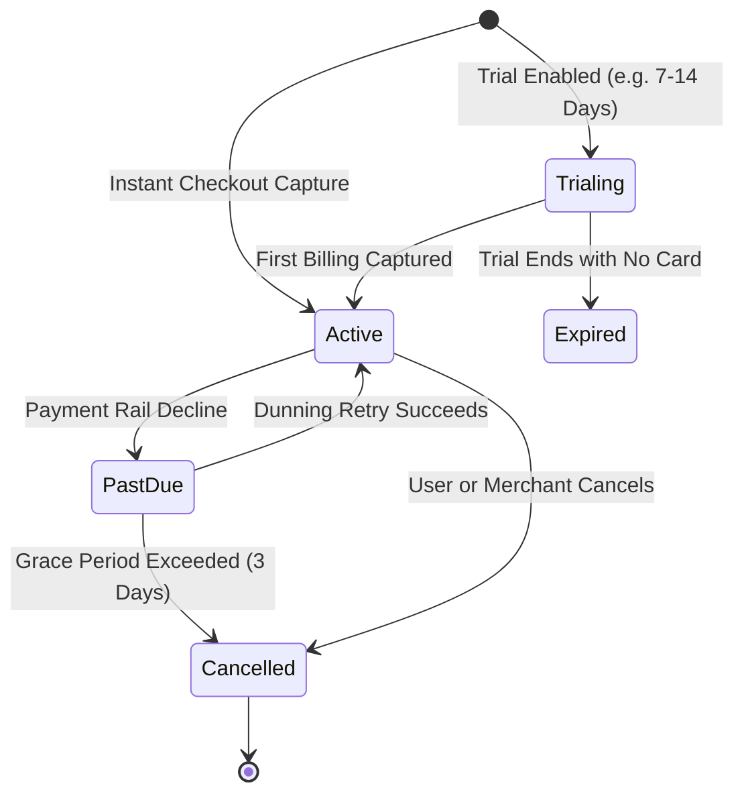

# Recurring Subscriptions & Billing Engine

180 Pay includes an open subscription platform that powers SaaS applications with automated renewal schedules, dunning grace periods, and instant webhook synchronization.



---

## 1. Subscription Lifecycle States

| Status | Meaning | Action Needed |
| :--- | :--- | :--- |
| **`TRIALING`** | User is in a free evaluation window (`trialDays > 0`). Full platform features are unlocked. | No immediate charge. |
| **`ACTIVE`** | Payment captured successfully. Billing period active until `currentPeriodEnd`. | Normal service delivery. |
| **`PAST_DUE`** | Auto-debit failed or insufficient funds. 180 Pay initiates a 3-day dunning recovery cycle. | Warn user in app banner. |
| **`CANCELLED`** | Subscription set not to renew, or cancelled via the Customer Portal. | Revoke premium access upon period expiration. |
| **`EXPIRED`** | Trial or grace period concluded without payment capture. | Lock access (`FeatureLock`). |

---

## 2. Defining Subscription Plans

Plans are created in your **180 Developer Console -> Pricing Tables** or programmatically via the backend API:

```http
POST /api/v1/subscriptions/plans
Host: services.180workspace.com
Authorization: Bearer <client_secret>
Content-Type: application/json

{
  "planCode": "traffic-pro",
  "name": "Pro Armor",
  "description": "5 Smart Links & Dynamic Shield Injection",
  "amount": 50.00,
  "currency": "USD",
  "interval": "MONTHLY", // "MONTHLY", "YEARLY", "WEEKLY"
  "intervalCount": 1,
  "trialDays": 0,
  "metadata": {
    "tier": "PRO",
    "maxLinks": 5,
    "features": [
      "Dynamic Client-Side Shield Injection",
      "Meta, Google & TikTok AdBot Cloaking",
      "5 Custom Domain Allocations"
    ]
  }
}
```

---

## 3. Automated Dunning & Grace Periods

When a subscription renewal fails:
1. **Day 0**: Customer is notified via email and in-app alert. Subscription moves to `PAST_DUE`.
2. **Day 1 - 3**: Smart retry scheduler attempts recovery at off-peak banking hours.
3. **Day 3 (Grace Period Cutoff)**: If payment cannot be secured after 3 days post-expiry, the subscription transitions to `EXPIRED` / `CANCELLED` and triggers the `subscription.cancelled` webhook.
