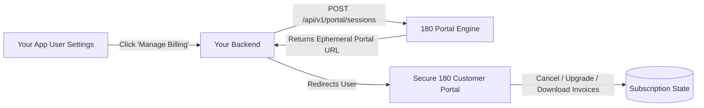

# Self-Service Customer Billing Portal

The **180 Customer Portal** gives your end-users complete self-service control over their active subscriptions, billing history, and payment methods without requiring you to build custom billing management UI.



---

## 1. Creating a Portal Session

Generate a secure, single-use portal session link from your backend:

### Request:
```http
POST /api/v1/portal/sessions
Host: services.180workspace.com
Authorization: Bearer <client_secret>
Content-Type: application/json

{
  "customerEmail": "sarah@acme.com",
  "externalCustomerId": "usr_12345",
  "returnUrl": "https://yourapp.com/settings/billing"
}
```

### Response:
```json
{
  "success": true,
  "portalUrl": "https://auth.180workspace.com/portal/pts_8a9b7c6d5e4f",
  "expiresAt": "2026-10-05T14:30:00.000Z"
}
```

---

## 2. Customer Portal Features

When the customer visits the ephemeral portal link, they can:
1. **View Active Subscriptions**: Current billing cycle, renewal date, and plan details.
2. **Download PDF Invoices**: Complete tax-compliant VAT/GST payment receipts.
3. **Change Payment Methods**: Update expired credit/debit cards or set default UPI handles.
4. **Self-Service Cancellation**: Allows customers to easily cancel renewals, automatically firing the `subscription.cancelled_by_customer` webhook to your backend.
