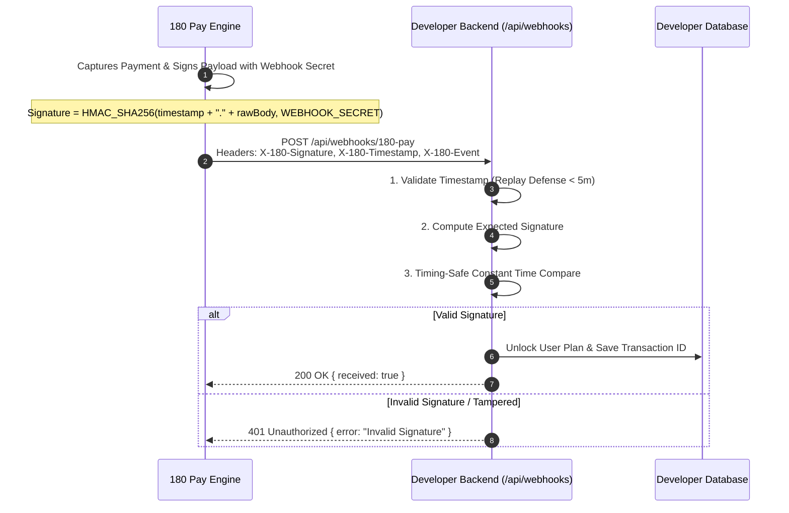

# Webhook Integration & HMAC Verification

When a payment succeeds, relying solely on client-side frontend redirects (e.g. `onSuccess` callback) is dangerous. Customers might close their browser tab, experience network drops, or attempt client-side spoofing.

**Webhooks are server-to-server HTTP POST notifications sent directly from 180 Core to your backend.** They guarantee that your application provisions user entitlements only after funds are cryptographically captured and verified.



---

## 1. Webhook Security Headers

Every webhook dispatch includes four security headers:

| Header Name | Format | Purpose |
| :--- | :--- | :--- |
| **`X-180-Signature`** | Hex string (64 chars) | Cryptographic HMAC-SHA256 signature calculated over `${timestamp}.${rawBody}` using your application's `WEBHOOK_SECRET`. |
| **`X-180-Timestamp`** | Integer string (e.g. `1728135600`) | Unix epoch seconds when the webhook was dispatched. Protects against replay attacks. |
| **`X-180-Event`** | String (e.g. `payment.captured`) | The event type being triggered. |
| **`User-Agent`** | `180-Pay-Webhook-Dispatcher/2.0` | Identifies the official 180 Pay webhook dispatcher daemon. |

---

## 2. Webhook Event Catalog

| Event Name | When Fired | Key Payload Fields |
| :--- | :--- | :--- |
| **`payment.captured`** | A one-time payment or initial checkout is authorized and captured. | `sessionId`, `amount`, `currency`, `customerEmail`, `metadata` |
| **`subscription.created`** | A new recurring subscription is activated (trial or paid). | `subscriptionId`, `planCode`, `amount`, `currentPeriodEnd`, `metadata` |
| **`subscription.renewed`** | Monthly/annual subscription successfully auto-debited. | `subscriptionId`, `amount`, `nextBillingDate`, `transactionId` |
| **`subscription.cancelled_by_customer`** | Customer cancels renewal through the customer portal. | `subscriptionId`, `planCode`, `cancelReason`, `currentPeriodEnd` |
| **`coupon.redeemed`** | A promotional discount code was applied during checkout. | `couponCode`, `discountAmount`, `sessionId` |
| **`identity.user.revoked`** | A user session was revoked from the Developer Console. | `userId`, `appId`, `revokedAt` |

---

## 3. Cryptographic Verification Algorithm

To verify an incoming webhook:
1. Extract the raw HTTP request body as an untouched string or Buffer. **Do not parse as JSON before verification.**
2. Extract the `X-180-Signature` and `X-180-Timestamp` headers.
3. Check the timestamp freshness against the current server time. Reject requests with more than **300 seconds (5 minutes)** of clock drift to prevent replay attacks.
4. Compute the expected HMAC SHA-256 signature:
   ```text
   Expected_Signature = HMAC_SHA256(timestamp + "." + rawBody, WEBHOOK_SECRET)
   ```
5. Compare the signatures using a **constant-time string comparison** (`crypto.timingSafeEqual`) to prevent timing side-channel attacks.

---

## 4. Production Code Implementations

### A. Next.js (App Router: `app/api/webhooks/180-pay/route.ts`)

```ts
import { NextResponse } from 'next/server';
import crypto from 'crypto';

export async function POST(req: Request) {
  try {
    // 1. Get raw body as string (CRITICAL: Do NOT use req.json() here)
    const rawBody = await req.text();
    const signature = req.headers.get('x-180-signature') || req.headers.get('X-180-Signature');
    const timestamp = req.headers.get('x-180-timestamp') || req.headers.get('X-180-Timestamp');
    const webhookSecret = process.env.ONE_EIGHTY_WEBHOOK_SECRET;

    if (!signature || !timestamp || !webhookSecret) {
      return NextResponse.json({ error: 'Missing security headers or secret' }, { status: 400 });
    }

    // 2. Replay attack defense (5-minute tolerance)
    const currentTime = Math.floor(Date.now() / 1000);
    const parsedTimestamp = parseInt(timestamp, 10);
    if (isNaN(parsedTimestamp) || Math.abs(currentTime - parsedTimestamp) > 300) {
      return NextResponse.json({ error: 'Timestamp expired / replay detected' }, { status: 401 });
    }

    // 3. Compute expected HMAC-SHA256 signature
    const signPayload = `${timestamp}.${rawBody}`;
    const expectedSignature = crypto
      .createHmac('sha256', webhookSecret)
      .update(signPayload)
      .digest('hex');

    // 4. Constant-time comparison
    const bufA = Buffer.from(signature);
    const bufB = Buffer.from(expectedSignature);
    if (bufA.length !== bufB.length || !crypto.timingSafeEqual(bufA, bufB)) {
      return NextResponse.json({ error: 'Invalid HMAC signature' }, { status: 401 });
    }

    // 5. Parse JSON payload and fulfill order
    const event = JSON.parse(rawBody);

    switch (event.event) {
      case 'payment.captured': {
        const { sessionId, amount, currency, metadata } = event.data;
        console.log(`Verified payment of ${currency} ${amount} for session ${sessionId}`);
        // TODO: Update your database: Mark user as upgraded
        break;
      }
      case 'subscription.renewed': {
        const { subscriptionId, currentPeriodEnd } = event.data;
        console.log(`Subscription ${subscriptionId} renewed until ${currentPeriodEnd}`);
        break;
      }
      case 'subscription.cancelled_by_customer': {
        const { subscriptionId } = event.data;
        console.log(`Subscription ${subscriptionId} cancelled`);
        break;
      }
      default:
        console.log('Received 180 Pay event:', event.event);
    }

    return NextResponse.json({ received: true });
  } catch (err: any) {
    console.error('Webhook processing failed:', err);
    return NextResponse.json({ error: err.message }, { status: 500 });
  }
}
```

---

### B. Node.js / Express (`server.js`)

In Express, make sure to preserve `req.rawBody` when using `express.json()`:

```js
const express = require('express');
const crypto = require('crypto');
const app = express();

// Capture raw body for signature verification
app.use(express.json({
  verify: (req, res, buf) => {
    req.rawBody = buf.toString();
  }
}));

app.post('/api/webhooks/180-pay', (req, res) => {
  const signature = req.headers['x-180-signature'];
  const timestamp = req.headers['x-180-timestamp'];
  const secret = process.env.ONE_EIGHTY_WEBHOOK_SECRET;

  if (!signature || !timestamp || !secret) {
    return res.status(400).json({ error: 'Missing security headers' });
  }

  // Check 5-minute replay window
  const currentTime = Math.floor(Date.now() / 1000);
  if (Math.abs(currentTime - parseInt(timestamp, 10)) > 300) {
    return res.status(401).json({ error: 'Timestamp expired' });
  }

  // Compute signature
  const signPayload = `${timestamp}.${req.rawBody}`;
  const expected = crypto.createHmac('sha256', secret).update(signPayload).digest('hex');

  const bufA = Buffer.from(signature);
  const bufB = Buffer.from(expected);
  if (bufA.length !== bufB.length || !crypto.timingSafeEqual(bufA, bufB)) {
    return res.status(401).json({ error: 'Invalid HMAC signature' });
  }

  const { event, data } = req.body;
  if (event === 'payment.captured') {
    console.log('Payment Captured:', data);
    // Fulfill user subscription in your database
  }

  res.status(200).json({ received: true });
});

app.listen(4000, () => console.log('Server running on port 4000'));
```

---

### C. Python (FastAPI)

```python
import hmac
import hashlib
import time
from fastapi import FastAPI, Request, HTTPException, status

app = FastAPI()
WEBHOOK_SECRET = "whsec_..."

@app.post("/api/webhooks/180-pay")
async def handle_180_webhook(request: Request):
    raw_body = await request.body()
    signature = request.headers.get("x-180-signature")
    timestamp = request.headers.get("x-180-timestamp")

    if not signature or not timestamp:
        raise HTTPException(status_code=400, detail="Missing signature or timestamp")

    # 1. Replay defense (5-minute tolerance)
    current_time = int(time.time())
    if abs(current_time - int(timestamp)) > 300:
        raise HTTPException(status_code=401, detail="Webhook timestamp expired")

    # 2. Compute expected HMAC
    sign_payload = f"{timestamp}.{raw_body.decode('utf-8')}".encode("utf-8")
    expected_sig = hmac.new(WEBHOOK_SECRET.encode("utf-8"), sign_payload, hashlib.sha256).hexdigest()

    # 3. Constant-time compare
    if not hmac.compare_digest(signature, expected_sig):
        raise HTTPException(status_code=401, detail="Invalid HMAC signature")

    payload = await request.json()
    event_type = payload.get("event")
    data = payload.get("data")

    if event_type == "payment.captured":
        print(f"Verified payment captured: {data}")
        # Fulfill user entitlement

    return {"received": True}
```

---

## 5. Testing Webhooks Locally

1. Start your local server on port 3000.
2. Start an [ngrok](https://ngrok.com) tunnel:
   ```bash
   ngrok http 3000
   ```
3. Copy your ngrok URL (e.g. `https://abc-123.ngrok-free.app/api/webhooks/180-pay`).
4. In the [180 Developer Console](https://developers.180workspace.com), go to your project's **Webhooks** tab, paste the URL, and click **Send Test Webhook**.
5. Your terminal will instantly log the received and verified event!
