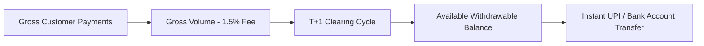

# Payouts, Settlements & Ledger

180 Pay features an automated double-entry ledger that tracks all gross transaction volume, 1.5% platform fees, and pending settlements.



---

## 1. Settlement Timeline

- **T+0 (Transaction Day)**: Funds captured from customers enter `Pending Settlements`.
- **T+1 (Clearing Day)**: After gateway settlement verification, funds are cleared into your project's `Withdrawable Balance`.
- **Payout Disbursement**: Once cleared, developers can withdraw their balance directly to their registered bank account or UPI ID.

---

## 2. Registering Settlement Bank Details

In the **180 Developer Console -> Payouts -> Settlement Bank Details** or via API:

```http
PUT /api/v1/developer/apps/:appId/bank-details
Host: services.180workspace.com
Authorization: Bearer <client_secret>
Content-Type: application/json

{
  "payoutMethod": "UPI", // "UPI" or "BANK_TRANSFER"
  "upiId": "developer@okhdfcbank",
  "accountHolderName": "Sovereign Labs LLC",
  "accountNumber": "1234567890",
  "ifscCode": "HDFC0001234"
}
```

---

## 3. Requesting a Payout via API

```http
POST /api/v1/identity/developer/apps/:appId/payouts/request
Host: services.180workspace.com
Authorization: Bearer <client_secret>
Content-Type: application/json

{
  "amount": 25000,
  "currency": "INR",
  "payoutMethod": "UPI",
  "accountDetails": {
    "upiId": "developer@okhdfcbank"
  }
}
```

### Response:
```json
{
  "success": true,
  "payout": {
    "id": "po_9a8b7c6d",
    "amount": 25000,
    "currency": "INR",
    "status": "PROCESSING",
    "requestedAt": "2026-10-05T14:30:00.000Z"
  }
}
```

Disbursements are processed via IMPS/NEFT rails within 2 to 4 business hours.
