# 180 Social Studio Overview

**180 Social Studio** is the all-in-one social media production, publishing, and automated lead capture workstation built for creators, media brands, growth marketing agencies, and modern marketing teams.

Historically, producing high-retention video content and converting viral social attention into actual revenue required juggling five to six disconnected tools: an AI text generator for scripting, a teleprompter app for recording, a desktop editor like CapCut or Premiere for cutting, a scheduling tool like Buffer or Hootsuite for publishing, an automation tool like ManyChat for comment-to-DM flows, and a separate CRM for sales.

180 Social Studio eliminates this fragmented stack by unifying the entire creative, distribution, and monetization lifecycle onto the **180 Sovereign Work Graph**.

```mermaid
graph LR
    subgraph "1. Ideation & Scripting"
        Idea[Content Idea / Article] --> AI[AI Script Director<br/>Multi-agent viral research & hooks]
    end

    subgraph "2. Filming & Recording"
        AI --> Tele[Inbuilt Teleprompter<br/>4K front camera with voice-synced scroll]
    end

    subgraph "3. Autonomous Editing"
        Tele --> Timeline[Multi-Track Video Engine<br/>WebGPU 60fps, smart stream-cut, kinetic captions]
    end

    subgraph "4. 1-Click Distribution"
        Timeline --> Push[Multi-Platform Publisher<br/>YouTube, IG, TikTok, X, LinkedIn, FB]
    end

    subgraph "5. Lead Capture & Monetization"
        Push --> AutoDM[Viral Auto-DM Engine<br/>Keyword comment triggers & funnels]
        AutoDM --> CRM[180 Workspace CRM<br/>Deals, pipeline & 180 Pay checkout]
    end
```

---

## The 6 Core Pillars of 180 Social Studio

### 1. AI Script Director
- **Multi-Agent Orchestration**: Specialized sub-agents research viral trends, craft high-retention hooks, draft structured body scripts, and suggest visual B-roll cues.
- **Brand Voice & Cadence Calibration**: Learns your distinct vocabulary, humor, and pacing across educational, contrarian, humorous, or enterprise tones.
- **1-Click Teleprompter Transfer**: Seamlessly send your polished script directly to the recording prompter with zero manual copy-pasting.

### 2. Inbuilt Teleprompter Camera
- **Front-Camera Web & Mobile Recording**: Read your script directly beside your device's camera lens to maintain natural, magnetic eye contact with your audience.
- **Synchronous Voice-Activated Scrolling**: The teleprompter dynamically tracks your spoken words in real time, pausing when you pause and adjusting to your natural conversational cadence.
- **Multi-Take Bookmarking**: Record multiple variations of your hook or intro in a single session and bookmark your favorites for instant timeline assembly.

### 3. Multi-Track Video Timeline Engine
- **Hardware-Accelerated 60fps Editing**: Non-linear multi-track editing powered by WebGPU and a local native media core for instant, lag-free scrubbing.
- **Lossless Smart Stream-Splicing**: Slices and trims untouched footage without re-encoding, reducing export times from minutes to seconds.
- **Kinetic Typography & Dynamic Captions**: Generates synchronized, word-highlighted karaoke subtitles with customizable fonts, bounce physics, and emoji accents.
- **Object & Face Attention Engine**: Automatically tracks faces and subjects to apply dynamic camera zooms, punch-ins, and auto-reframing for vertical (9:16) format.

### 4. 1-Click Multi-Platform Publishing
- **Unified Distribution**: Schedule and publish content across Instagram (Reels & Feed), YouTube (Shorts & Long-Form), TikTok, X (Twitter), LinkedIn, and Facebook with a single click.
- **Automated Format Adaptation**: Automatically reframes aspect ratios, optimizes bitrates, and tailors captions and character limits per social network.
- **Best-Time-To-Post AI**: Recommends optimal posting windows based on your audience's unique historical engagement heatmaps.

### 5. Viral Auto-DM Lead Automation
- **Keyword Comment Triggers**: When viewers comment keywords like `"BLUEPRINT"` or `"SCALE"` on your reels, videos, or posts, Social Studio instantly sends private DMs with download links, coupon codes, or booking links.
- **Multi-Step Conversational Funnels**: Qualify prospects directly inside the DM with interactive buttons, lead magnets, and contact information capture.
- **Direct CRM Ingestion**: Every engaged follower is instantly logged as an enriched lead within **180 Workspace CRM**.

### 6. Analytics & Interactive Content Calendar
- **Cross-Platform Performance Aggregator**: View aggregated impressions, engagement rates, and drop-off curves across all connected social profiles in one centralized dashboard.
- **Audience Retention Curves**: Inspect second-by-second viewer drop-off analytics to identify high-performing hooks and optimize future video pacing.
- **Attributed Revenue Reporting**: Connect views, comments, and DM conversations directly to completed transactions and subscription revenue via **180 Pay**.

---

## Tool Consolidation Comparison

| Capability | Traditional Disjointed Tool Stack | 180 Social Studio |
| :--- | :--- | :--- |
| **Scriptwriting** | ChatGPT / Claude ($20/mo) | **Native Multi-Agent Script Director** with retention frameworks |
| **Teleprompter** | Teleprompter Premium / PromptSmart ($15/mo) | **Inbuilt Voice-Synced 4K Teleprompter** |
| **Video Editing** | CapCut Pro / Premiere / Descript ($25-$40/mo) | **Multi-Track WebGPU Video Timeline** with smart stream-splicing |
| **Social Scheduling** | Buffer / Hootsuite / Later ($18-$49/mo) | **1-Click Multi-Platform Publisher** with best-time AI |
| **Comment-to-DM** | ManyChat Pro ($15-$65/mo) | **Native Auto-DM Automation Engine** with CRM sync |
| **CRM & Sales Pipeline** | HubSpot / Pipedrive ($30-$90/mo) | **180 Workspace CRM & Work Graph** natively connected |
| **Estimated Monthly Cost** | **$118 – $279 / month** | **Included in 180 Platform Subscription** |

---

## 180 Work Graph Integration

180 Social Studio does not operate as an isolated silo. It is deeply connected to the entire 180 Workspace platform:

- **180 Workspace CRM**: Social Studio automatically provisions leads, captures emails, and tags contacts with originating social post IDs and campaign names.
- **180 Storage & Assets**: Raw 4K footage, generated B-roll, motion graphics, and audio stems are securely stored with multi-tenant company isolation.
- **180 Pay**: Distribute personalized, one-click checkout links and dynamic coupon codes directly inside automated DM sequences.
- **180 Traffic Director**: Seamlessly transition high-performing organic video posts into paid advertising campaigns with intelligent edge link routing and bot filtering.

---

## Social Studio Documentation Index

Explore the comprehensive guides below to master every aspect of 180 Social Studio:

- **[Auto-DM Automation](/docs/products/180-social-studio/auto-dm-automation)**: Set up keyword triggers, automated conversation flows, and lead qualification funnels.
- **[Multi-Platform Publishing](/docs/products/180-social-studio/multi-platform-publishing)**: Connect your social accounts, schedule queues, and adapt video formats across 6 networks.
- **[AI Script Director](/docs/products/180-social-studio/ai-script-director)**: Generate viral hooks, full production scripts, and custom brand voice profiles.
- **[Inbuilt Teleprompter Camera](/docs/products/180-social-studio/inbuilt-teleprompter-camera)**: Record flawless takes with voice-synced auto-scrolling and magnetic eye contact.
- **[Multi-Track Video Timeline Engine](/docs/products/180-social-studio/video-editor-and-timeline)**: Edit videos with 60fps WebGPU rendering, lossless stream splicing, auto-zoom, and kinetic captions.
- **[Analytics & Visual Calendar](/docs/products/180-social-studio/analytics-and-calendar)**: Monitor cross-platform engagement, audience retention curves, and content calendars.
- **[Creator Playbook & Workflows](/docs/products/180-social-studio/creator-playbook-and-workflows)**: Step-by-step master workflow: from blank page to viral video and paid clients in 15 minutes.
