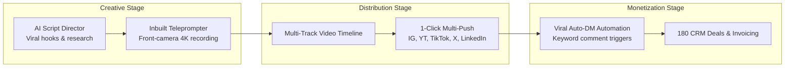

# 180 Social Studio Overview

**180 Social Studio** is an all-in-one social media production, publishing, and automated lead capture workstation designed for solo creators, media brands, and growth marketing agencies.

Instead of juggling separate subscriptions for script generation, teleprompter recording, video timeline editing, multi-network scheduling, and Instagram comment-to-DM automation, 180 Social Studio integrates the entire creative pipeline into a single, cohesive workflow.

---

## The 5 Core Pillars of 180 Social Studio

### 1. AI Script Director
- **Multi-Agent Scriptwriting**: Researches trending viral topics, produces punchy hook variations, and outputs structured scripts formatted with timing markers and visual cues.
- **Tone & Persona Matching**: Learns your distinct voice across educational, provocative, comedic, or corporate tones.

### 2. Inbuilt Teleprompter Camera
- **Front-Camera Web & Mobile Recording**: Read your script directly next to your camera lens to maintain natural eye contact.
- **Voice-Activated Auto-Scroll**: Scrolls synchronously as you speak using local Web Speech / Whisper recognition, pausing automatically when you hesitate.

### 3. Multi-Track Video Timeline Engine
- **Non-Linear Web & Native Editing**: Virtualized timeline supporting video cuts, audio ducking, subtitle burning, and canvas aspect ratio switching (9:16 vertical, 16:9 widescreen, 1:1 square).
- **GPU-Accelerated Rendering**: WebGPU and native Rust engine acceleration for fast exports without server queues.

### 4. 1-Click Multi-Platform Publishing
- **Unified Scheduling & Distribution**: Queue content to Instagram Reels, YouTube Shorts, TikTok, X (Twitter), LinkedIn, and Facebook with a single click.
- **Platform-Specific Optimization**: Automatically formats captions, character limits, hashtags, and thumbnail frames per network.

### 5. Viral Auto-DM Lead Automation
- **Keyword Comment Triggers**: When viewers comment "PROMPT" or "SCALE", Social Studio automatically delivers private links, lead magnets, or checkout forms directly to their DMs.
- **Direct CRM Ingestion**: Captured leads and contact information are fed directly into **180 Workspace CRM**.

---

## Social Studio Navigation Guides

- **[Auto-DM Automation](/docs/products/180-social-studio/auto-dm-automation)**: Configure keyword triggers and automated conversation flows.
- **[Multi-Platform Publishing](/docs/products/180-social-studio/multi-platform-publishing)**: Connect social accounts and schedule content across networks.
- **[AI Script Director](/docs/products/180-social-studio/ai-script-director)**: Generate high-retention video scripts and viral hooks.
- **[Inbuilt Teleprompter Camera](/docs/products/180-social-studio/inbuilt-teleprompter-camera)**: Record videos with synchronized speech scrolling.
- **[Analytics & Visual Calendar](/docs/products/180-social-studio/analytics-and-calendar)**: Monitor content performance and plan upcoming campaigns.
