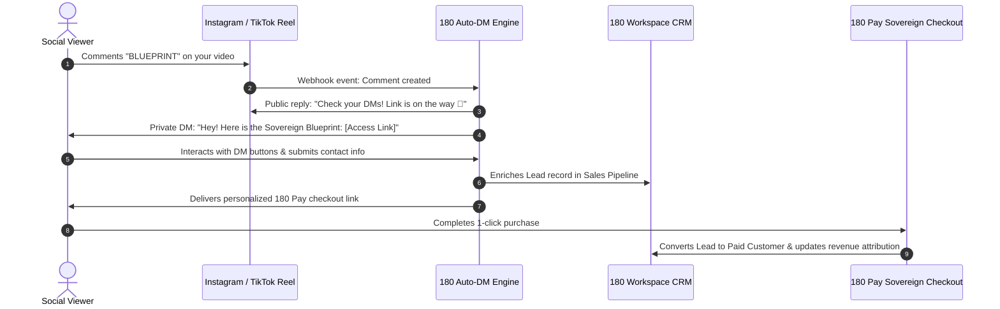

# Auto-DM Automation & Viral Lead Capture

The **180 Auto-DM Automation** engine turns social media engagement into qualified leads, customer relationships, and direct revenue. When followers or viral viewers comment specific keywords on your reels, videos, or posts, 180 Social Studio automatically delivers a personalized direct message containing your resource, free training, discount code, or 1-Click checkout link.

---

## 1. Supported Platforms & Native Partner APIs

180 Auto-DM operates via official social media partner APIs, ensuring 100% compliance with platform terms of service and zero risk of shadowbanning:

| Platform | Trigger Scope | Automation Capabilities |
| :--- | :--- | :--- |
| **Instagram** | Reel comments, feed post comments, story mentions & replies, live comments | Instant DM delivery, interactive quick-reply buttons, public comment auto-replies with randomized variation. |
| **Facebook** | Page posts, reels, sponsored ad comments | Messenger delivery with interactive card carousels, webview links, and lead forms. |
| **TikTok** | Video comments (via TikTok Business Messaging API) | Direct message response with link stickers and verification. |
| **X (Twitter)** | Post replies and quote tweets | Direct message response with link delivery and lead collection. |
| **LinkedIn** | Post comments | Automated connection messaging and resource delivery. |

---

## 2. Trigger Rule Configuration

Setting up an automated response campaign takes less than two minutes:

### A. Keyword Matching Precision
- **Exact Keyword Matching**: Triggers only when a comment matches an exact string (e.g., `"BLUEPRINT"`, `"SCALE"`).
- **Fuzzy & Natural Variation Matching**: Catches common typos and variations (e.g., matching `"blueprint"`, `"Blueprint!"`, `"send blueprint plz"`).
- **Multi-Keyword Triggers**: Assign multiple trigger words to the same campaign (e.g., `"TEMPLATE"`, `"GUIDE"`, `"LINK"`).

### B. Anti-Bot Public Comment Variation
Replying with the exact same automated comment to hundreds of users looks robotic and triggers platform spam filters. 180 Social Studio enforces randomized reply rotation:
- Configure a pool of 5 to 10 distinct public reply templates:
  - *"Sent to your DMs! Check your message requests 🚀"*
  - *"Just dropped the link in your DM! Let me know what you think 🔥"*
  - *"Check your inbox! The guide is waiting for you 📥"*
- The system automatically rotates through the variations with randomized emoji substitutions.

### C. Human-Like Delay Randomization
- Configure an organic delay interval (e.g., 15 to 45 seconds) between comment creation and DM dispatch.
- Protects your account reputation by mimicking human behavior while maintaining high conversion speed.

### D. Negative Keyword & Spam Filtering
- Automatically suppress DM delivery on comments containing banned words, competitor links, spam emojis, or negative sentiment.

---

## 3. Interactive Multi-Step DM Conversion Funnels

Rather than sending a static, easily forgotten link, 180 Auto-DM allows you to build engaging, interactive conversation funnels directly inside the chat interface:

### 1. Interactive Quick-Reply Buttons
Present followers with tappable buttons to segment their intent before sending a link:
> *"Awesome! To make sure I send the right version, what is your current monthly revenue?"*
> - **[Under $10k/mo]**
> - **[$10k – $50k/mo]**
> - **[$50k+/mo]**

### 2. In-Chat Contact Ingestion
- Prompt viewers to enter their email address or WhatsApp phone number directly in the DM.
- The system validates formatting in real time and automatically creates or updates the contact profile in **180 Workspace CRM**.

### 3. Dynamic 180 Pay Link Distribution
- Generate unique, single-use discount coupon codes or personalized 1-Click checkout links powered by **180 Pay**.
- If a prospect drops off mid-checkout, the Auto-DM engine can send a gentle reminder message 2 hours later.

---

## 4. Native Work Graph & CRM Sync

Every interaction generated by an Auto-DM trigger synchronizes with the **180 Work Graph**:

- **Automated Lead Creation**: A new **Lead** is automatically created in **180 Workspace CRM**, tagged with the originating post ID, reel title, and trigger keyword.
- **Deal Pipeline Stage Assignment**: Leads indicating high intent (e.g., enterprise budget or urgent timeline) are instantly moved to the "Qualified Lead" stage.
- **Instant Team Notifications**: Alert sales representatives via desktop push notification or mobile notification when a high-value prospect engages with your campaign.
- **Attributed Revenue Analytics**: Track the full financial lifecycle from the initial video comment to the final settled payment.
