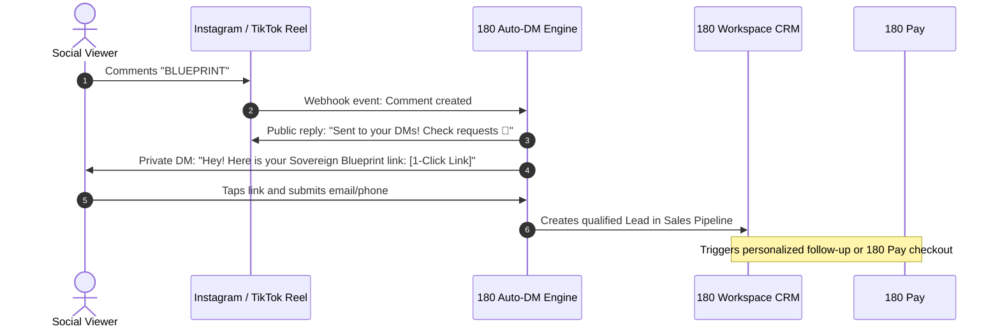

# Auto-DM Automation & Viral Lead Capture

The **180 Auto-DM Automation** engine turns social media engagement into qualified sales leads and revenue. When followers or viral viewers comment specific keywords on your posts, reels, or videos, 180 Social Studio automatically sends a personalized private direct message with your free resource, discount code, or 1-Click checkout link.

---

## 1. Multi-Platform Support

180 Auto-DM operates across all major creator platforms via official partner APIs:

| Platform | Trigger Scope | Capabilities |
| :--- | :--- | :--- |
| **Instagram** | Reel comments, Post comments, Story replies, Live comments | Instant DM delivery, interactive quick-reply buttons, public comment auto-reply with randomized variation. |
| **Facebook** | Page posts, Ads comments | Instant Messenger delivery with rich cards and carousels. |
| **TikTok** | Video comments (where supported via Business API) | Automated DM with link stickers and verification. |
| **X (Twitter)** | Post replies and quote tweets | Direct message response containing access tokens. |
| **LinkedIn** | Post comments | Automated invitation to connect and InMail resource link. |

---

## 2. Trigger Rule Configuration

Create automated response rules in minutes:

- **Exact & Fuzzy Keyword Matching**: Trigger on exact words (`"SCALE"`, `"TEMPLATE"`, `"ACCESS"`) or fuzzy variations (`"scale"`, `"Scale!"`, `"plz scale"`).
- **Randomized Public Comment Replies**: Avoid looking like a repetitive bot by providing 5-10 public reply variations (e.g. *"Check your DMs!"*, *"Sent your way!"*, *"Just sent the link in DM 🔥"*).
- **Exclusion Filters**: Filter out negative keywords, spam links, or vulgar comments automatically.
- **Delay Intervals**: Add natural 10-60 second randomized delays to simulate organic human response timing and protect account reputation.

---

## 3. Interactive DM Funnels & Data Collection

Deliver more than static links:
1. **Interactive Quick-Reply Buttons**: Ask qualifying questions inside the DM (e.g. *"What is your current monthly revenue? <$10k | $10k-$50k | $50k+"*).
2. **Phone & Email Ingestion**: Capture contact details within the conversation flow.
3. **Dynamic Coupon Code Generation**: Distribute unique, single-use 180 Pay discount codes to increase conversion urgency.

---

## 4. Native CRM & Work Graph Integration

Every prospect who engages with an Auto-DM flow is automatically converted into an entity on the **180 Work Graph**:
- A new **Lead** is created in **180 Workspace CRM** tagged with the originating post ID and campaign name.
- Contact books are enriched with the viewer's social handle and phone number.
- High-intent leads (e.g. those selecting high revenue tiers) trigger immediate push notifications to sales reps.
