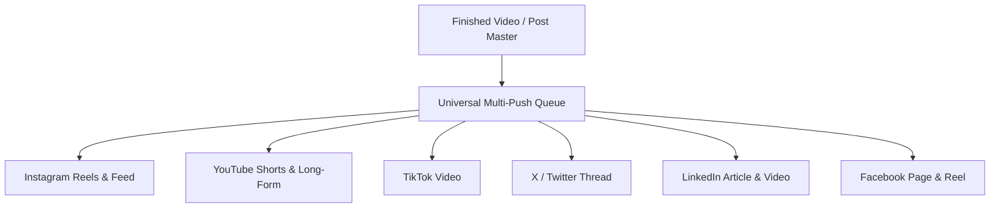

# 1-Click Multi-Platform Publishing

Publishing content across multiple social channels typically forces creators to download massive video files, manually re-upload them to five different mobile apps, re-type descriptions, and adjust video dimensions repeatedly.

**180 Multi-Platform Publishing** reduces this entire process to a single click.

---

## 1. Supported Networks & Formats

| Platform | Supported Formats | Specific Capabilities |
| :--- | :--- | :--- |
| **YouTube** | Shorts (9:16), Long-Form (16:9) | Custom thumbnail uploads, tag management, playlist assignment, age-rating flags. |
| **Instagram** | Reels, Carousels, Single Images | Audio trending recommendations, user tagging, location tagging, collaborator invites. |
| **TikTok** | Vertical Video (9:16) | Sound pairing, duet/stitch permission toggles, commercial content disclosure. |
| **LinkedIn** | Native Video, PDF Documents, Text | Hashtag formatting, company page vs. personal profile routing. |
| **X (Twitter)** | Videos, Photos, Multi-Tweet Threads | Thread splitting with numbered tweets, poll attachments. |
| **Facebook** | Pages, Groups, Reels | Cross-posting from Instagram, scheduled premiere events. |

---

## 2. Automated Format Adaptation

Different platforms have strict codecs, aspect ratios, and file size constraints. Social Studio's background transcoding pipeline handles these automatically:

- **Aspect Ratio Formatting**: Intelligently re-frames 16:9 widescreen footage into 9:16 vertical video using AI subject tracking.
- **Transcoding & Bitrate Optimization**: Compresses footage to platform-optimal H.264/AAC presets, avoiding server-side degradation and upload errors.
- **Caption & Character Tailoring**: Write a master caption, then customize specific character lengths (e.g. 280 characters for X vs. 2,200 for Instagram) without starting over.

---

## 3. Visual Scheduling Queue & Best-Time AI

- **Interactive Calendar Drag-and-Drop**: View scheduled posts on monthly, weekly, or daily visual grids. Reschedule posts simply by dragging them to new dates.
- **Audience Activity Heatmaps**: AI analyzes your audience's historical engagement patterns to recommend optimal posting hours per network.
- **Approval Workflows for Agencies**: Agency clients can review drafts, leave timestamped comments, and sign off on posts before they go live.
