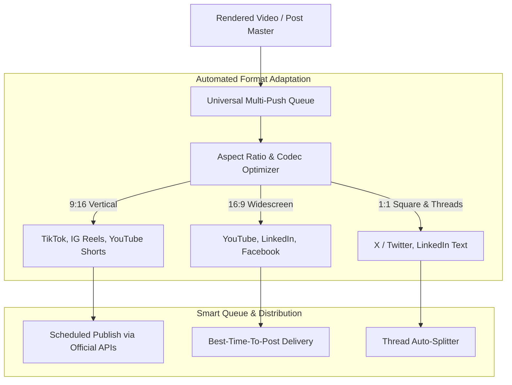

# 1-Click Multi-Platform Publishing

Publishing content across multiple social channels typically forces creators to download massive video files, manually re-upload them to five different mobile apps, re-type descriptions, re-select thumbnails, and adjust video dimensions repeatedly.

**180 Multi-Platform Publishing** reduces this entire process to a single click.

---

## 1. Supported Networks & Feature Matrix

180 Social Studio connects directly to official developer APIs across all major platforms:

| Platform | Supported Formats | Native Platform Capabilities |
| :--- | :--- | :--- |
| **YouTube** | Shorts (9:16), Long-Form (16:9, up to 4K) | Custom thumbnail selection, tags, playlist assignment, age-restriction flags, category selection. |
| **Instagram** | Reels (9:16), Carousels, Feed Posts, Stories | Trending audio pairing recommendations, user tagging, collaborator invitations, location tagging. |
| **TikTok** | Vertical Video (9:16, up to 10 mins) | Trending sound pairing, duet and stitch permission toggles, commercial content disclosure. |
| **LinkedIn** | Native Video, PDF Carousels, Articles, Text | Company Page vs. Personal Profile routing, hashtag formatting, targeted audience visibility. |
| **X (Twitter)** | Videos, Images, Multi-Tweet Threads | Automatic thread splitting with numbered tweets, character counter, poll attachments. |
| **Facebook** | Pages, Groups, Reels | Cross-posting from Instagram, scheduled premiere events, video category tags. |

---

## 2. Automated Format & Aspect Ratio Adaptation

Different social platforms impose strict requirements on aspect ratios, bitrates, audio channels, and maximum file sizes. Social Studio's background transcoding pipeline adapts your master video automatically:

### A. Intelligent Aspect Ratio Reframing
- **16:9 to 9:16 Vertical**: Intelligently pans and scans widescreen footage into vertical video using **AI Subject & Face Tracking**, keeping the speaker or focal point centered in every frame.
- **Dynamic Background Fill**: Alternatively, wrap 16:9 footage in a styled blurred background or branded canvas frame tailored for vertical feeds.
- **1:1 Square Formatting**: Optimized for LinkedIn and Facebook feed carousels.

### B. Hardware Transcoding & Bitrate Optimization
- Automatically compresses footage to optimal platform presets (H.264/AAC for mobile feeds; VP9/AV1 for YouTube).
- Avoids server-side degradation, upload stalls, and compression artifacts caused by uploading unsupported bitrates.

### C. Master Caption Tailoring
- Write a single master caption, then customize platform-specific versions without duplicating your work:
  - **X (Twitter)**: Automatically clips to 280 characters or splits into a numbered thread.
  - **Instagram**: Expands up to 2,200 characters with organized hashtag blocks.
  - **YouTube**: Formats title and description with clickable timestamps and resource links.
  - **LinkedIn**: Structures professional formatting with bullet points and bold unicode headings.

---

## 3. Visual Scheduling & Best-Time-To-Post AI

- **Interactive Drag-and-Drop Calendar**: View your upcoming publication schedule across monthly, weekly, and daily grids. Reschedule posts simply by dragging their card to a new date or time slot.
- **Audience Activity Heatmaps**: AI analyzes your audience's historical engagement patterns across each network to recommend the exact hour and minute when your followers are most active.
- **Smart Queue Slots**: Define recurring time slots (e.g., *Weekdays at 9:00 AM* and *Tuesdays at 6:30 PM*). New content added to the queue automatically fills the next available slot.

---

## 4. Agency & Team Approval Workflows

For marketing agencies and multi-member creative teams, 180 Social Studio includes built-in review and sign-off workflows:

- **Client Review Portals**: Share branded, view-only preview links where clients can review scheduled posts, play videos, and read captions without needing a platform login.
- **Timestamped Feedback**: Stakeholders can leave timestamped comments directly on video frames to request edits.
- **Role-Based Publishing Permissions**: Require creator drafts to be approved by a Team Lead or Account Manager before being queued for live publication.
