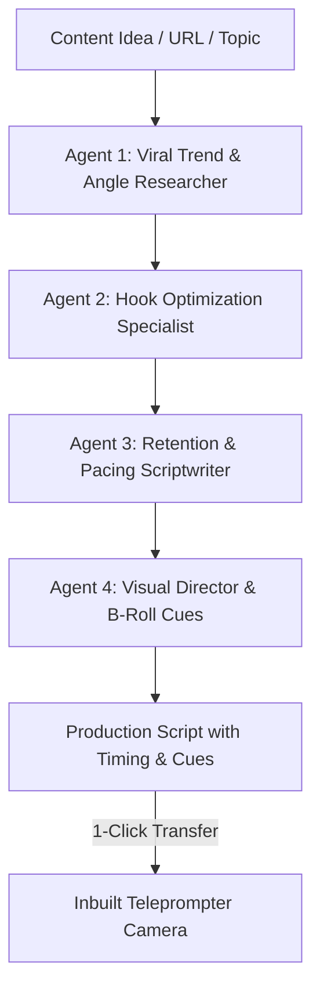

# AI Script Director & Creative Ideation

The **AI Script Director** serves as your 24/7 creative writer, viral research strategist, and retention pacing coach. Rather than relying on generic, single-prompt chat outputs, the Director coordinates a specialized multi-agent workflow grounded in retention metrics from millions of high-performing short-form and long-form videos.



---

## 1. Multi-Agent Script Generation Workflow

The AI Script Director divides script production across four specialized cognitive sub-agents:

### Agent 1: Viral Trend & Angle Researcher
- Analyzes existing viral conversations across YouTube, TikTok, and LinkedIn to identify market fatigue and discover contrarian, high-curiosity angles.
- Extracts unique statistics, surprising case studies, or counter-intuitive arguments to make your content stand out from cliché advice.

### Agent 2: Hook Optimization Specialist
- Generates 5 to 10 distinct opening hook variations engineered for the critical first 3 seconds of short-form video.
- Tests hooks across proven cognitive frameworks:
  - **The Pattern Interrupt**: Violates expected viewer assumptions immediately (*"Stop posting every day if you want to grow."*).
  - **The Curiosity Gap**: Withholds a crucial resolution (*"There is a hidden setting inside iOS that 99% of creators don't know exists."*).
  - **The Contrarian Truth**: Directly challenges standard industry dogma (*"Your CRM is actually costing you 40% of your sales pipeline."*).
  - **The High-Stakes Story**: Hooks viewers with immediate tension (*"We almost lost our biggest client last Tuesday. Here is what happened."*).

### Agent 3: Retention & Pacing Scriptwriter
- Drafts the core narrative using the **Hook-Story-Offer** retention structure.
- Enforces strict pacing rules: no single sentence extends beyond 6 seconds without a verbal punch, contrast, or question.
- Inserts natural pauses and phonetic cues tailored for smooth oral delivery when reading from the teleprompter.

### Agent 4: Visual Director & B-Roll Cues
- Automatically annotates the script with bracketed production cues for visual assets:
  - B-roll clips (e.g., `[VISUAL: Screen recording of dashboard]`)
  - Sound effects (e.g., `[SFX: Subtle paper rustle]`)
  - On-screen kinetic text overlays (e.g., `[TEXT CALLOUT: "$12,450 / mo"]`)

---

## 2. Production-Ready Script Format

Scripts produced by the AI Director are formatted specifically for filming with the Inbuilt Teleprompter:

```markdown
[0:00 - HOOK / PATTERN INTERRUPT]
"Most SaaS founders are throwing away $4,000 every single month on software they don't even use."
[VISUAL: Red X stamps over logos of HubSpot, Slack, ManyChat]
[SFX: Low bass drop]

[0:04 - THE PROBLEM]
"Here is the brutal truth: your CRM doesn't speak to your ad tracker, and your video editor doesn't speak to your DM bot."
[VISUAL: Screen capture of tangled Zapier error logs]

[0:14 - THE CONTRARIAN SHIFT]
"When you fragment your business across six tools, your data leaks and your conversion rates plummet."
[TEXT OVERLAY: "Tool Fragmentation = Conversion Leaks"]

[0:25 - THE SOLUTION & STORY]
"That is why we built 180 Social Studio on the Sovereign Work Graph..."
[VISUAL: Smooth 60fps walkthrough of unified 180 Workspace dashboard]

[0:45 - THE CALL TO ACTION]
"Comment the word 'BLUEPRINT' below and I'll send you our complete architecture guide directly to your DMs."
[VISUAL: Arrow pointing down to comment section]
```

---

## 3. Brand Voice & Persona Calibration

- **Voice Profile Ingestion**: Provide links to 3 to 5 of your top-performing videos, articles, or transcripts. The Director extracts your signature vocabulary, cadence, sentence length, and humor style.
- **Tone Presets**: Toggle between *Educational & Authoritative*, *Contrarian & Provocative*, *Casual & Conversational*, or *Corporate & Institutional*.
- **Custom Brand Guardrails**: Define mandatory terms, prohibited competitor mentions, and custom sign-offs to maintain brand safety across multi-creator teams.
- **1-Click Teleprompter Transfer**: Once approved, transfer the script to the **Inbuilt Teleprompter Camera** with zero copy-pasting.
