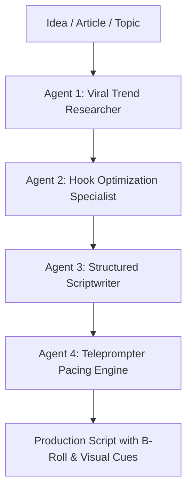

# AI Script Director & Creative Ideation

The **AI Script Director** acts as your 24/7 creative writer, research strategist, and pacing coach. Using multi-agent prompt orchestration grounded in millions of high-performing short-form video metrics, the Director transforms vague thoughts or long-form blog posts into tightly structured, viral video scripts.



---

## 1. Multi-Agent Script Generation Architecture

Rather than relying on generic, single-prompt LLM outputs, the AI Director coordinates specialized sub-agents:

1. **Trend & Angle Researcher**: Evaluates existing viral discussions on YouTube and TikTok, identifying gaps and contrarian perspectives.
2. **Hook Optimization Specialist**: Produces 5-10 hook variations tested against proven retention frameworks (curiosity gap, pattern interrupt, social proof, fear of missing out).
3. **Pacing & Retention Scriptwriter**: Drafts the body content using the **Hook-Story-Offer** framework, ensuring no sentence drags longer than 6 seconds without a verbal punch or pattern change.
4. **Visual Director**: Injects bracketed cues for visual b-roll footage, sound effects (SFX), and on-screen text callouts.

---

## 2. Structured Script Output Format

Scripts generated by the AI Director are structured specifically for recording:

```markdown
[0:00 - HOOK]
"Most SaaS founders are wasting $4,000 a month on software they don't even use."
[VISUAL: Red X over logos of HubSpot, Slack, ManyChat]

[0:04 - PROBLEM]
"Here is the brutal truth: your CRM doesn't talk to your ad tracker, and your video editor doesn't talk to your DM bot."
[VISUAL: Screen recording of messy Zapier errors]

[0:15 - SOLUTION & STORY]
"That is why we built the 180 Sovereign Work Graph..."
[VISUAL: Clean 180 Workspace dashboard walkthrough]

[0:45 - CALL TO ACTION]
"Comment the word 'SOVEREIGN' below and I'll send you our complete architecture blueprint for free."
```

---

## 3. Brand Voice & Persona Fine-Tuning

- **Voice Ingestion**: Provide links to 3 of your best-performing videos or written articles; the AI Director extracts your vocabulary, cadence, and humor style.
- **Custom Brand Guardrails**: Specify banned words, competitor mentions to avoid, or mandatory sign-offs.
- **Direct Teleprompter Handoff**: With one click, the generated script transfers to the **Inbuilt Teleprompter Camera** for recording.
