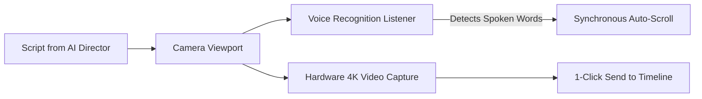

# Inbuilt Teleprompter Camera & Recording

Reading a script off a sheet of paper or a distant monitor leads to wandering eyes, stiff delivery, and countless discarded takes.

The **Inbuilt Teleprompter Camera** in 180 Social Studio turns any laptop or smartphone into a professional broadcast studio. By projecting your script directly next to your device's camera sensor, you maintain locked, magnetic eye contact with your viewer while delivering flawless, confident takes.

---

## 1. Key Capabilities

### 1. Synchronous Voice-Activated Scrolling
Unlike primitive teleprompters that scroll at a fixed, robotic words-per-minute (WPM) speed, 180 Teleprompter listens to your voice:
- As you speak, the prompter highlights the active words and scrolls dynamically.
- If you pause to take a breath or emphasize a dramatic point, the prompter pauses.
- If you repeat a sentence, the prompter adapts without jumping ahead.

### 2. Magnetic Eye-Contact Alignment
- The text overlay can be resized and dragged directly under the front camera lens.
- A narrower text column prevents your eyes from scanning left-to-right, eliminating the telltale "reading eyes" appearance.

### 3. Studio Camera Controls
- **Resolution & Frame Rate**: Record in 1080p or 4K at 30fps / 60fps depending on your hardware.
- **Microphone Selection & Audio Monitoring**: Visual audio meters detect background noise or audio clipping before you begin recording.
- **Countdown Timer**: 3-second or 5-second countdown with visual flash to prepare before recording starts.

---

## 2. Multi-Take Management

- **Take Bookmarking**: Record 3 or 4 variations of your hook in a single session. Mark preferred takes with a star.
- **Instant Playback Review**: Scrub through the take immediately after stopping to verify audio clarity and lighting.
- **Direct Export to Timeline**: Send your best take straight to the video editing timeline with zero download or file transfer steps.
