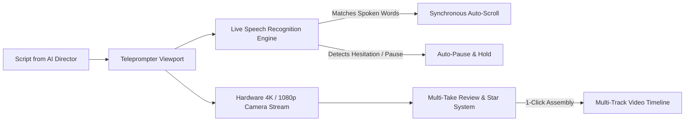

# Inbuilt Teleprompter Camera & Recording

Reading a script off a printed sheet of paper or a secondary monitor results in darting eyes, stiff delivery, and dozens of discarded takes.

The **Inbuilt Teleprompter Camera** in 180 Social Studio turns any laptop, tablet, or smartphone into a professional broadcast studio. By positioning your script directly beside your device's camera sensor and synchronizing scrolling to the cadence of your voice, you maintain natural, magnetic eye contact with your viewers while delivering confident, one-take recordings.

---

## 1. Core Recording Capabilities

### A. Synchronous Voice-Activated Scrolling
Unlike primitive teleprompters that scroll at a rigid, robotic words-per-minute (WPM) speed, 180 Teleprompter listens to your voice via local, high-precision speech recognition:
- **Speech-Following Pacing**: As you speak, the prompter highlights active words in real time and advances the text automatically.
- **Natural Pause Detection**: If you pause to emphasize a dramatic point, catch your breath, or smile at the camera, the prompter immediately pauses.
- **Repeat & Stumble Recovery**: If you misspeak and repeat a sentence, the prompter detects the repetition and resets to the beginning of the phrase without skipping ahead.

### B. Magnetic Eye-Contact Alignment
- **Ultra-Narrow Text Column**: Constrains text to a narrow column directly beneath your device's camera lens. This eliminates horizontal eye movement, ensuring viewers perceive genuine, direct eye contact.
- **Draggable & Resizable Prompter Window**: Reposition the transparent prompter overlay anywhere on your screen to align perfectly with external webcams or smartphone lenses.
- **Adjustable Font Sizing & High-Contrast Modes**: Choose between white-on-black, yellow-on-black, or transparent backdrop overlays with scalable typography for effortless readability from 2 to 10 feet away.

### C. Studio Camera & Audio Controls
- **Resolution & Frame Rates**: Capture in crisp 1080p or uncompressed 4K at 30fps or 60fps depending on your camera hardware.
- **Audio Monitoring & Noise Gate**: Live VU meters display audio gain in real time, alerting you to background hums or clipping distortion before you begin recording.
- **Visual Countdown & Pre-Roll Flash**: Customizable 3-second or 5-second countdown timer gives you time to compose your posture and smile before the recording begins.
- **Mirror Video Toggle**: Mirror your front-camera feed for a natural webcam recording experience.

---

## 2. Multi-Take Management & Instant Timeline Assembly

Filming short-form video often requires recording 2 to 3 variations of your opening hook:

- **Take Bookmarking**: Record multiple takes consecutively without stopping the recording session. Press the Spacebar or a Bluetooth remote to bookmark the start of each take.
- **Star & Select Favorites**: Quickly review takes immediately after filming. Star your preferred take (e.g., *Take 2*) to designate it as the master.
- **Instant Timeline Assembly**: Click **"Send to Timeline"** to import your best take directly into the **Multi-Track Video Timeline Engine** with zero file export or transfer wait times.
