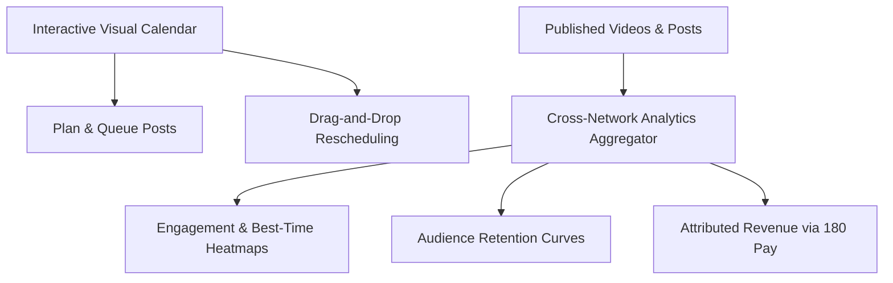

# Analytics & Interactive Content Calendar

Managing a multi-channel content strategy requires clear forward planning and granular retrospective insights. The **Analytics & Content Calendar** in 180 Social Studio provides creators and agencies with a birds-eye visual timeline of all upcoming releases alongside unified, cross-platform performance metrics.

---

## 1. Interactive Visual Content Calendar

- **Multi-View Modes**: Switch effortlessly between Monthly overview, Weekly production schedules, and Daily task lists.
- **Color-Coded Status Tags**: Track content across its lifecycle (*Idea*, *Scripting*, *Filmed*, *Editing*, *Scheduled*, *Published*).
- **Drag-and-Drop Scheduling**: Reschedule posts simply by dragging their card to another day or time slot on the grid.
- **Campaign Grouping**: Group posts by campaign (e.g. *Black Friday Launch*, *Podcast Repurposing*, *Lead Magnet Drive*) to evaluate cohesive multi-post initiatives.

---

## 2. Unified Cross-Platform Analytics

Stop logging into six different social media analytics portals to calculate aggregate views:

| Metric | Cross-Platform Aggregation | Business Value |
| :--- | :--- | :--- |
| **Total Reach & Impressions** | YouTube + Instagram + TikTok + LinkedIn + X + FB | Total brand footprint across networks. |
| **Average Watch Time & Retention** | Second-by-second drop-off curve comparison | Identifies which hooks keep viewers engaged longest. |
| **Engagement Rate** | (Likes + Comments + Shares + Saves) / Impressions | Identifies viral outliers worth boosting with paid ads. |
| **Auto-DM Conversions** | Keyword triggers fired & links clicked | Measures tangible marketing pipeline generated. |
| **Attributed Revenue** | Closed deals and 180 Pay settlements | Connects content directly to bottom-line financial return. |

---

## 3. Best-Time-To-Post Heatmaps

- **Dynamic Follower Activity Analysis**: Visual color heatmaps illustrate exactly when your active followers are browsing each network.
- **Automated Scheduling Slotted Windows**: Schedule posts into "Smart Slots" that automatically publish at the peak engagement hour for that specific network.
