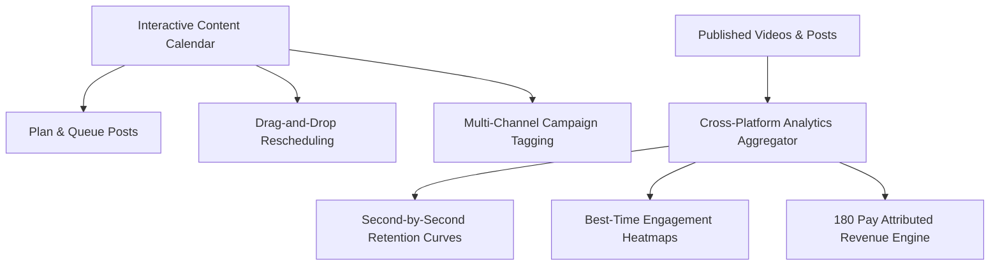

# Analytics & Interactive Content Calendar

Managing an omni-channel social strategy requires forward-looking visual planning alongside granular retrospective performance metrics. The **Analytics & Content Calendar** in 180 Social Studio equips creators, media brands, and growth agencies with a birds-eye visual timeline of all upcoming releases alongside cross-platform audience analytics.

---

## 1. Interactive Visual Content Calendar

The 180 Social Studio calendar provides complete visibility over your publishing pipeline:

- **Multi-View Flexibility**: Seamlessly toggle between **Monthly Overview**, **Weekly Production**, and **Daily Queue** layouts.
- **Color-Coded Production Stages**: Track posts through each phase of production (*Idea*, *Scripting*, *Filmed*, *Editing*, *Review*, *Scheduled*, *Published*).
- **Drag-and-Drop Scheduling**: Need to postpone a release? Simply drag a post card to a new day or time slot on the calendar grid; all platform webhooks update instantly.
- **Campaign Grouping & Filters**: Organize posts by overarching initiatives (e.g., *Product Launch 2026*, *Podcast Repurposing*, *Lead Magnet Drive*) to evaluate campaign performance as a cohesive unit.

---

## 2. Unified Cross-Platform Analytics

Eliminate the need to log into six different analytics dashboards to piece together your performance:

| Metric | Cross-Platform Aggregation | Growth & Business Insight |
| :--- | :--- | :--- |
| **Total Reach & Impressions** | YouTube + Instagram + TikTok + LinkedIn + X + FB | Total audience footprint and brand velocity across networks. |
| **Average Watch Time & Retention** | Second-by-second drop-off curve comparison | Identifies which hooks maintain attention past the critical 3-second mark. |
| **Engagement Rate** | (Likes + Comments + Shares + Saves) / Impressions | Highlights viral outliers and indicates posts worthy of paid ad amplification. |
| **Auto-DM Conversions** | Keyword triggers fired & link clicks | Measures qualified marketing leads generated by content. |
| **Attributed Revenue** | Closed deals & settled payments via **180 Pay** | Directly links content production to cash in bank and ARR growth. |

---

## 3. Second-by-Second Retention Analytics

For video content, high view counts mean nothing if viewers leave after 4 seconds:

- **Granular Drop-off Curves**: Visual charts display the exact percentage of viewers watching at every second of playback.
- **Hook Effectiveness Scoring**: Compares your video's 0-to-3 second drop-off rate against platform averages (e.g., *Top 10% retention* vs. *Below average*).
- **Dead Air & Pacing Identification**: Identify dips in retention to diagnose pacing drag, ineffective jokes, or unengaging visuals, allowing you to tighten future scripts.

---

## 4. Best-Time-To-Post Heatmaps

- **Dynamic Follower Activity Analysis**: Visual color heatmaps illustrate exactly when your active followers are browsing each network.
- **Smart Posting Windows**: Schedule posts into automated "Smart Slots" that publish when your target audience is most active on that specific network.

---

## 5. Attributed Revenue via 180 Pay

The ultimate measure of social media is business revenue:

- Every lead magnet link and checkout URL distributed via **Auto-DM** is tagged with a unique cryptographic attribution token.
- When a customer purchases a product, signs a retainer, or subscribes via **180 Pay**, the revenue is directly attributed to the exact video, hook, and social platform that initiated the relationship.
- Review your **Return on Creative Time (ROCT)** to determine which content formats generate the highest pipeline value.
