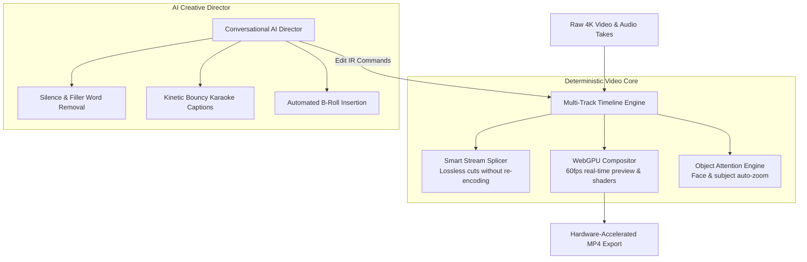

# Multi-Track Video Timeline Engine & Autonomous Video Production

The **Multi-Track Video Timeline Engine** in 180 Social Studio bridges the gap between lightweight mobile video apps and complex professional non-linear editors (NLEs). Engineered with a high-performance local-first architecture, the engine combines **60fps hardware-accelerated preview**, **instant smart stream-splicing**, **kinetic auto-captions**, and an **Autonomous AI Creative Director** into a fluid, lag-free editing experience.

---

## 1. Local-First 60fps WebGPU Viewport

Traditional web-based video editors suffer from sluggish playback, dropped frames, and memory crashes when scrubbing high-resolution footage. 180 Social Studio solves this by deploying a local-first rendering architecture:

- **WebGPU Shader Pipeline**: Renders color grades, blur transitions, text overlays, and canvas compositions at a butter-smooth 60 frames per second directly on your local GPU.
- **Instant Timeline Scrubbing**: A bounded ring buffer and proxy media engine enable instantaneous forward and backward playhead scrubbing through 4K 60fps footage without stutter.
- **Exact Rational Timebase**: All timestamps and durations are computed using exact rational fractions (`RationalTime`), eliminating audio/video desynchronization drift over long recordings.

---

## 2. Lossless Smart Stream-Splicing

Exporting edited videos usually requires re-encoding every single frame, turning a 3-minute video export into a 10-minute wait:

- **Zero-Loss Stream Copy**: Untouched sections of your video are copied directly at the binary stream level without re-encoding.
- **Instant Cut Exports**: If you are simply cutting out dead air, stumbles, or filler words, your video exports in seconds rather than minutes with zero quality loss.
- **Hybrid GOP Smart Splicing**: For cuts that fall on non-keyframe boundaries, only the initial leading frames up to the nearest keyframe are re-encoded; the remaining segment is copied losslessly.

---

## 3. Kinetic Typography & Dynamic Auto-Captions

Over 85% of mobile social video is watched with the sound turned off. Clear, engaging subtitles are non-negotiable for viewer retention:

- **Speech-Synchronized Word Highlighting**: Generates animated, bouncy "karaoke-style" captions synchronized down to the millisecond.
- **Retention Preset Styles**: Choose between popular viral creator presets (e.g., *Alex Hormozi Yellow/Green Highlight*, *Sleek Minimal Dark*, *Pop Neon*, *Glow Outline*).
- **Auto-Emoji & Keyword Accents**: Automatically inserts animated emojis and emphasis colors over key power words (e.g., *"revenue"*, *"mistake"*, *"scale"*).
- **Multi-Language Support**: Transcribes and translates captions across 50+ languages with automatic punctuation formatting.

---

## 4. Object & Face Attention Engine (Auto-Zoom)

Dynamic camera motion keeps viewers visually engaged:

- **Automated Subject Tracking**: Detects faces, speakers, or products and automatically applies smooth spring-physics zoom cuts on punchy sentences.
- **Aspect Ratio Smart Framing**: Automatically pans and frames 16:9 widescreen footage for 9:16 vertical displays, ensuring the primary speaker never drifts out of frame.
- **Manual Zoom Regions**: Add smooth zoom-in and zoom-out keyframes simply by selecting an area of interest in the viewport.

---

## 5. Conversational AI Creative Director

Edit your video using natural language instructions via the **Universal AI Drawer**:

- *"Remove all silences longer than 0.5 seconds."*
- *"Add dynamic zoom cuts every time I introduce a new point."*
- *"Find and cut all filler words ('um', 'uh', 'you know')."*
- *"Reframe this project to 9:16 vertical and generate viral yellow captions."*
- *"Insert relevant stock B-roll over the second story segment."*

All AI commands produce deterministic, transactional edit actions on the timeline. Every AI change can be reviewed, fine-tuned, or instantly undone with `Ctrl+Z`.
