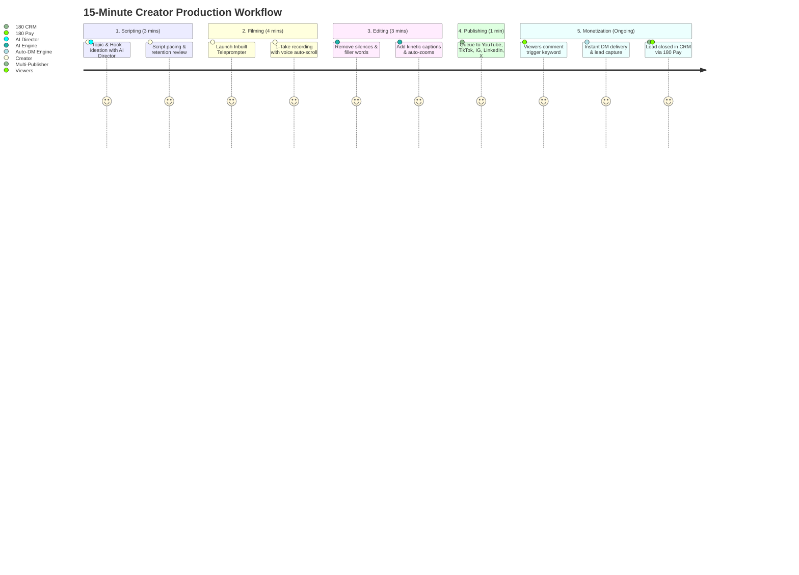

# Creator Playbook & End-to-End Workflows

This playbook walks through the master **15-Minute Production-to-Revenue Workflow** in 180 Social Studio. Learn how solo creators, media brands, and growth agencies take an initial concept and turn it into a high-retention video, an automated DM lead funnel, and booked revenue inside **180 Workspace CRM**.

---

## Phase 1: Scripting with the AI Director (Minutes 0 – 3)

1. Open **180 Social Studio** and click **"New Project"** $\rightarrow$ **"AI Script Director"**.
2. Enter your core topic, paste an article URL, or describe a recent client win.
3. Select your desired tone (e.g., *Contrarian & Provocative*) and set the target duration to *45–60 seconds*.
4. Review the 5 generated hook variations. Select the strongest hook (e.g., *"Stop posting daily reels until you fix this one conversion leak"*).
5. Review the generated structured script with its visual cues and pacing markers.
6. Click **"Transfer to Teleprompter"**.

---

## Phase 2: One-Take Filming with the Inbuilt Teleprompter (Minutes 3 – 7)

1. Position your laptop or phone at eye level.
2. Select your camera resolution (**4K 30fps** or **1080p 60fps**) and verify audio levels using the live VU meter.
3. Click **"Record"** (a 3-second visual countdown starts).
4. Deliver your script naturally. The teleprompter listens to your voice and scrolls in perfect synchronicity with your natural pacing:
   - If you pause for emphasis, the text halts.
   - If you stumble on a sentence, repeat it; the prompter rewinds to the start of the line automatically.
5. Hit **"Stop"** and click **"Send to Video Timeline"**.

---

## Phase 3: Autonomous Polish in the Video Timeline (Minutes 7 – 10)

1. In the **Multi-Track Video Timeline Engine**, open the **Universal AI Drawer**.
2. Click **"Cut Silences & Filler Words"**:
   - The engine automatically slices out pauses longer than 0.4 seconds and removes stutter takes.
3. Click **"Apply Kinetic Captions"**:
   - Select the *Viral Bold Karaoke* preset with yellow word highlighting and dynamic emoji accents.
4. Click **"Auto-Zoom Punch-Ins"**:
   - The Object Attention Engine detects your face and applies subtle 1.15x camera zooms on every transitional point.
5. Click **"Export MP4"**:
   - Thanks to **Lossless Smart Stream-Splicing**, your polished video renders in under 20 seconds.

---

## Phase 4: Configure the Viral Auto-DM Campaign (Minutes 10 – 12)

1. Navigate to **Auto-DM Automation** $\rightarrow$ **"Create Trigger"**.
2. Select **Instagram Reel** and **TikTok Video** as target platforms.
3. Set the trigger keyword to:
   - **`"BLUEPRINT"`** (with fuzzy matching enabled for *"blueprint"*, *"Blueprint!"*, and *"send blueprint"*).
4. Configure 5 randomized public comment replies:
   - *"Sent to your DMs! Check requests 🚀"*
   - *"Just sent the complete guide to your DM 🔥"*
   - *"Check your inbox! Link is waiting for you 📥"*
5. Build the private DM flow:
   - Deliver the greeting: *"Hey! Here is your private access link to the Sovereign Blueprint:"*
   - Add a 1-Click download button.
   - Add an interactive qualification button: *"Are you currently running ads? [Yes] / [Not Yet]"*.

---

## Phase 5: 1-Click Multi-Platform Publishing (Minutes 12 – 13)

1. Navigate to **Multi-Platform Publishing** $\rightarrow$ **"Compose Post"**.
2. Select all target destinations:
   - **Instagram Reels**
   - **YouTube Shorts**
   - **TikTok**
   - **LinkedIn Video**
   - **X (Twitter)**
3. Write your master caption, including your call to action:
   > *"Comment the word 'BLUEPRINT' below and I'll send you our complete architecture guide directly to your DMs."*
4. Click **"Schedule for Best Time"**:
   - Social Studio's AI analyzes your audience engagement heatmaps and queues the post for your peak engagement window.

---

## Phase 6: Automated Lead Ingestion & Revenue Attribution (Ongoing)

Once your video goes live, the monetization cycle runs autonomously:

1. **Viewer Comments**: A viewer comments *"BLUEPRINT"* on your Instagram reel.
2. **Auto-DM Fired**: The viewer receives your private DM within 20 seconds, taps the link, and enters their email.
3. **CRM Lead Created**: A new Lead is automatically created in **180 Workspace CRM**, tagged with `#Reel-Blueprint-Campaign`.
4. **Deal Notification**: Your sales team receives a desktop notification: *"New high-intent lead captured from Instagram Reel"*.
5. **Checkout & Revenue Attribution**: The lead purchases a product or signs a retainer via **180 Pay**. 180 Social Studio marks the video with the attributed revenue, completing the closed-loop growth cycle.
