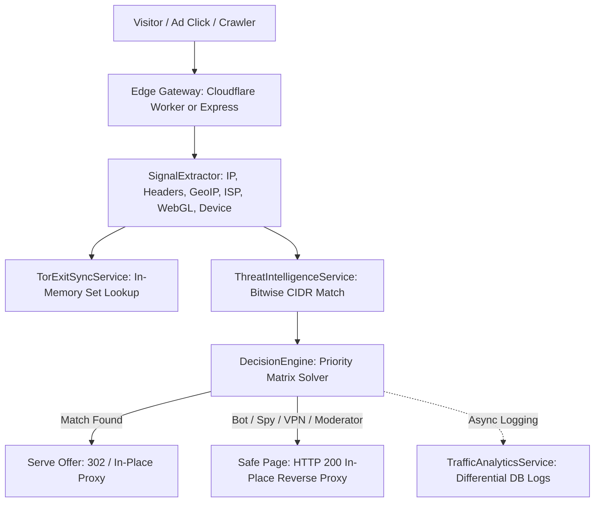

# 180 Traffic Director Overview

**180 Traffic Director** is an enterprise-grade conditional traffic routing, bot/moderator protection, differential evaluation, and edge cloaking platform engineered directly into the 180 Platform monorepo.

Designed to outperform specialized standalone tools like Cloaking.house, Traffic Director provides sovereign advertisers, media buyers, affiliate marketers, and growth teams with high-speed, sub-millisecond traffic filtering without third-party subscriptions or traffic volume caps.

---

## 1. Core Architectural Pillars

### 1. Sub-Millisecond Edge Evaluation
Traditional cloaking tools make blocking external API requests back to central servers, adding 150ms-500ms of latency that kills conversion rates and alerts ad platform crawlers. 180 Traffic Director evaluates signals **directly at the edge in `< 1ms`** using in-memory rule sets and unsigned integer CIDR bitmasking.

### 2. Threat Intelligence Feeds
- **Tor Exit Node Synchronization**: Continuous background polling maintaining ~1,850+ active Tor exit nodes in an $O(1)$ in-memory hash set.
- **Datacenter & Cloud ASN Blocking**: Instant screening of AWS, GCP, Azure, DigitalOcean, and Oracle Cloud IP blocks.
- **Known Ad Reviewer & Crawler Signatures**: Meta, TikTok, Google, Bing, and ByteDance moderator crawlers are intercepted automatically.

### 3. Differential Content Delivery (HTTP 200 Reverse Proxy)
When an ad platform review bot or competitor spy tool visits your tracking link, Traffic Director serves a legitimate, compliant "Safe Page" with an **HTTP 200 OK status code via in-place reverse proxying**. To the crawler's inspection engine, the site appears completely static and benign, preventing flag triggers or account suspensions.

### 4. Dynamic Macro Interpolation & Attribution
Forward ad network tokens (such as Meta's `{{campaign.id}}`, TikTok's `__CAMPAIGN_ID__`, or Google's `{campaignid}`) dynamically into downstream offer landing pages and Server-to-Server (S2S) postback pixels.

---

## 2. Key Performance Benchmarks

| Metric | 180 Traffic Director | Industry Standalone Tools (Cloaking.house) |
| :--- | :--- | :--- |
| **Edge Latency** | `< 1ms` (In-Memory bitwise match) | 120ms - 450ms (External REST round-trip) |
| **Traffic Caps** | **Unlimited** (Sovereign infrastructure) | Tiered pricing with strict monthly click limits |
| **Safe Page Delivery** | Transparent HTTP 200 Reverse Proxy | 302 Redirect (often flagged by ad reviewers) |
| **Work Graph Integration** | Native to 180 CRM & 180 Pay | Isolated CSV exports |

---

## Traffic Director Navigation Guides

- **[Edge Evaluator Proxy](/docs/products/180-traffic-director/edge-evaluator-proxy)**: Edge Worker architecture, request routing, and latency optimization.
- **[Threat Intelligence & Bot Defense](/docs/products/180-traffic-director/threat-intelligence-and-bot-defense)**: Fingerprinting, crawler mitigation, and threat feeds.
- **[Ads Attribution & Dynamic Macros](/docs/products/180-traffic-director/ads-attribution-and-macros)**: Macro substitution and Server-to-Server conversion postbacks.
