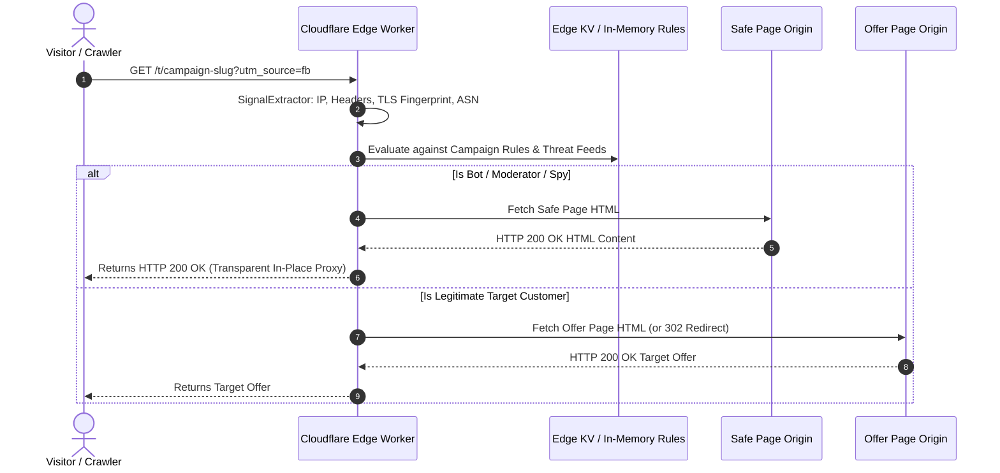

# Edge Evaluator Proxy & Routing Engine

The **Edge Evaluator Proxy** is the operational frontline of 180 Traffic Director. Executing either at Cloudflare Edge Workers or high-performance Node.js gateways, it intercepts incoming HTTP requests, extracts rich client fingerprints, executes rule evaluations against in-memory rule sets, and delivers the designated response with zero perceptible latency.



---

## 1. Sub-Millisecond Signal Extraction

When a request arrives, the `SignalExtractor` compiles a structured client footprint in under 0.2ms:

- **Network Signals**: Client IPv4/IPv6, Autonomous System Number (ASN), ISP name, Proxy/VPN headers (`CF-Connecting-IP`, `X-Forwarded-For`, `True-Client-IP`).
- **Device & Client Signals**: Clean parsed User-Agent, Operating System, Browser Engine, Device Form Factor (Mobile, Tablet, Desktop).
- **Geolocation Signals**: Country Code (ISO-3166), Region/State, City, and Postal Code.
- **Protocol & Security Signals**: TLS cipher suite fingerprint, Accept headers, Language headers (`Accept-Language`).

---

## 2. In-Place Reverse Proxying vs. 302 Redirection

Most legacy trackers rely solely on HTTP 302/301 redirects to steer traffic. However, modern advertising review bots (Meta Ad Reviewer, Googlebot, TikTok Crawler) treat immediate redirects as suspicious signals.

180 Traffic Director supports **Transparent In-Place Reverse Proxying**:

```typescript
// Edge Worker In-Place Proxy Logic
if (verdict === 'SERVE_SAFE_PAGE') {
  const safeResponse = await fetch(campaign.safePageUrl, {
    headers: {
      'User-Agent': request.headers.get('User-Agent') || '',
      'Accept': request.headers.get('Accept') || '',
      'Accept-Language': request.headers.get('Accept-Language') || '',
    },
  });

  // Preserve HTTP 200 status code and stream body
  return new Response(safeResponse.body, {
    status: 200,
    headers: {
      'Content-Type': safeResponse.headers.get('Content-Type') || 'text/html',
      'Cache-Control': 'no-store, no-cache, must-revalidate',
    },
  });
}
```

### Advantages:
1. **URL Uniformity**: The browser address bar remains on the initial tracking link (`https://track.yourdomain.com/special-deal`).
2. **Reviewer Invisibility**: Automated compliance bots receive a normal HTTP 200 response containing valid, policy-compliant web content.
3. **No Redirect Chain Drop-offs**: Eliminates DNS re-resolution and SSL negotiation delays.

---

## 3. High-Velocity Cloudflare Worker Integration

Deploy Traffic Director as a serverless Cloudflare Worker:
- **Sub-5ms Execution Worldwide**: Code runs in over 300 Cloudflare data centers within 50ms of 95% of the world's population.
- **Edge KV Rule Cache**: Active campaign rules and threat lists are synchronized to Cloudflare Workers KV.
- **Asynchronous Analytics Logging**: Click events and conversion attribution logs are dispatched out-of-band using `ctx.waitUntil()`, ensuring zero delay on the user response.
