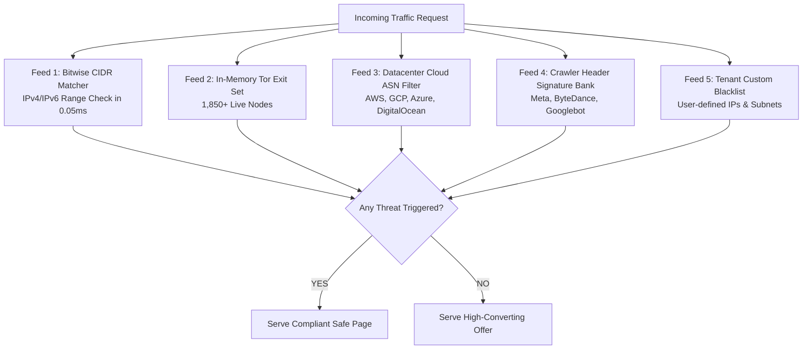

# Threat Intelligence & Bot Defense

The **Threat Intelligence & Bot Defense** subsystem is responsible for detecting and screening out hostile traffic before it reaches your conversion funnels. This includes ad network compliance review bots, automated scrapers, competitor spy tools, proxy/VPN tunnels, and malicious Tor exit nodes.

---

## 1. The 5 Core Threat Intelligence Feeds

### Feed 1: Bitwise IPv4 CIDR Matching Engine
Traditional IP matching loops through arrays of string subnets, causing $O(N)$ CPU bottlenecks. 180 Traffic Director converts all IPv4 ranges into unsigned 32-bit integer bitmasks:

$$\text{Match} = (\text{Client IP} \ \& \ \text{Subnet Mask}) == \text{Subnet Network Integer}$$

This allows evaluating a client against thousands of known moderator subnets in less than **0.05 milliseconds**.

### Feed 2: Live Tor Exit Directory Synchronization
A background synchronization service continuously polls official Tor directory authorities every 4 hours, caching the complete active list of ~1,850+ exit nodes in an $O(1)$ in-memory hash set.

### Feed 3: Datacenter & Cloud Hosting ASN Filter
Legitimate consumers browse from residential and cellular networks (Comcast, Jio, Verizon, AT&T). Traffic originating from datacenter ASNs (Amazon AWS, Google Cloud, Microsoft Azure, OVH, Hetzner, DigitalOcean) is automatically flagged as non-human or automated proxy traffic.

### Feed 4: Ad Platform Moderator Signatures
Identifies official automated crawler User-Agents and header fingerprints:
- **Meta / Facebook**: `facebookexternalhit/*`, `Facebot`, `Meta-Ad-Reviewer`
- **TikTok / ByteDance**: `Bytespider`, `ByteDance-Reviewer`
- **Google**: `Googlebot-Image`, `AdsBot-Google`, `Mediapartners-Google`
- **Ad Spy Tools**: Anstrex, AdPlexity, SpyOver, PowerAdSpy crawlers.

### Feed 5: Tenant Custom Blacklists
Every organization can define custom IP blocks, country blacklists, or ASN filters tailored to their specific advertising campaigns.

---

## 2. Cloaking Superiority Matrix

How 180 Traffic Director compares to specialized third-party cloaking platforms:

| Feature / Capability | 180 Traffic Director | Cloaking.house | Generic Link Shorteners |
| :--- | :--- | :--- | :--- |
| **Evaluation Latency** | **`< 1ms`** | 150ms - 400ms | 50ms - 100ms |
| **Edge Deployment** | Cloudflare Workers & Node.js | Centralized Cloud Server | Centralized Cloud |
| **Safe Page Delivery** | **HTTP 200 Reverse Proxy** | 302 Redirect Only | 302 Redirect Only |
| **Bitwise CIDR Engine** | Native 32-bit Integer Masking | Linear String Search | None |
| **Tor Exit Node Sync** | Automated 4-Hour Polling | Static / Manual | None |
| **Monthly Click Fee** | **$0 (Included in Platform)** | $30 - $100 / month | Free / Paid Tiers |
| **Sovereign Work Graph** | Native link to CRM & Pay | None (CSV export) | None |
