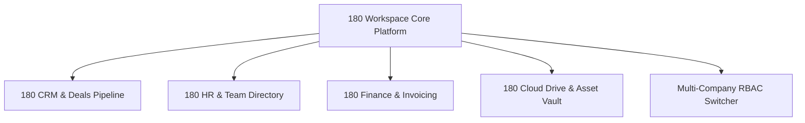

# 180 Workspace Suite Overview

**180 Workspace** is a modular enterprise operations suite engineered to run companies of any scale without the friction, fragmented logins, and exorbitant per-seat costs of traditional SaaS suites.

---

## The Unified Modular Architecture

Rather than forcing organizations to adopt an all-or-nothing monolith, 180 Workspace is architected as an array of cohesive modules bound together by the Sovereign Work Graph:

1. **CRM & Sales Pipeline**: Turn raw prospect inquiries into closed-won contracts with customizable drag-and-drop Kanban boards, automated lead scoring, and customer contact cards.
2. **HR & Team Operations**: Manage employee directories, org hierarchies, leave requests, attendance logs, and payroll calculations from a single unified pane.
3. **Finance & Invoicing**: Generate dynamic multi-currency invoices, manage recurring client billing, reconcile payments against 180 Pay, and monitor revenue ledgers.
4. **Storage & Assets**: High-speed, encrypted cloud file drive featuring role-based folder permissions, link sharing, and multi-tenant file separation.
5. **Multi-Company Management**: Seamlessly switch between multiple parent and subsidiary companies, clients, or agency accounts without signing out.

---

## Key Business Workflows

### 1. Lead-to-Project Fulfillment Pipeline
When a prospect signs an agreement in the CRM:
- The Deal moves to `CLOSED_WON`.
- 180 Workspace automatically instantiates a corresponding `Project` record with assigned team members, timelines, and milestone checkpoints.
- No manual double-entry of client data is required.

### 2. Time Tracking to Automated Payroll & Invoicing
- Team members log hours against active client projects.
- At the end of each billing cycle, internal background jobs aggregate timesheets.
- Client-billable hours are compiled into draft multi-currency invoices.
- Internal hours are compiled into employee payroll statements ready for approval.

---

## Role-Based Access Control (RBAC)

180 Workspace implements five organizational permission tiers:

| Role | CRM Scope | HR & Payroll Scope | Finance & Billing | Storage Scope |
| :--- | :--- | :--- | :--- | :--- |
| **Owner** | Full Admin | Full Admin | Full Admin | Root Access |
| **Admin** | Full Admin | Full Admin | Approvals & Invoices | Root Access |
| **Manager** | Team Pipeline | Team Attendance & Approvals | View Invoices | Team Folders |
| **Member** | Assigned Leads | Personal Timesheets & Leaves | None | Shared Folders |
| **Guest / Client** | Shared Deals Only | None | View & Pay Client Invoices | Shared Client Assets |

---

## Workspace Navigation Guides

- **[CRM & Sales Pipeline](/docs/products/180-workspace/crm-and-sales)**: Configure lead stages, customer books, and sales velocity tracking.
- **[HR & Team Management](/docs/products/180-workspace/hr-and-team)**: Manage employees, leave policies, and payroll workflows.
- **[Finance & Invoicing](/docs/products/180-workspace/finance-and-invoicing)**: Setup multi-currency invoicing and automatic payment collection.
- **[Storage & Assets](/docs/products/180-workspace/storage-and-assets)**: Cloud storage organization, asset security, and permissions.
- **[Multi-Company Management](/docs/products/180-workspace/multi-company-management)**: Switch organizations and configure company-level security.
