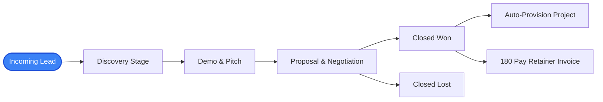

# CRM & Sales Pipeline

The **180 CRM** module empowers sales teams, founders, and account managers to track every customer touchpoint from first inquiry to contract execution. Built directly on the Sovereign Work Graph, leads captured from ads (via 180 Traffic Director) or viral social interactions (via 180 Social Studio) land directly in the sales pipeline without manual data entry.

---

## 1. Visual Deal Pipelines & Kanban Customization

180 CRM provides dynamic, drag-and-drop Kanban boards that reflect your company's actual sales stages:

- **Custom Deal Stages**: Customize pipeline stages (e.g. *Lead In*, *Discovery Call*, *Proposal Sent*, *Contract Signed*, *Onboarding*).
- **Deal Probability Weighting**: Assign win probabilities per stage to calculate real-time weighted sales forecasts.
- **Stage Stagnation Alerts**: Automatically flag deals that have lingered in a stage beyond a configured SLA threshold.

---

## 2. Universal Contact & Account Directory

Every customer in 180 Workspace is cataloged under a consolidated **Account Profile**:

- **Unified Interaction Timeline**: Chronological log of emails, phone calls, meeting notes, and internal team mentions.
- **Sovereign Profile Enrichment**: Automatically associates client `@username` credentials and WhatsApp phone numbers for 1-click messaging.
- **Associated Deals & Invoices**: Direct visibility into historical contracts, open proposals, and settled invoices on the same screen.

---

## 3. Automated Lead Capture & Routing

Leads enter the CRM through three primary channels:

| Ingestion Channel | Mechanism | Work Graph Action |
| :--- | :--- | :--- |
| **Traffic Director Ingestion** | Ad click conversion with UTM parameters | Ingests lead with verified geolocation and ad campaign attribution tag. |
| **Social Studio Auto-DM** | Prospect responds to keyword trigger on Instagram or TikTok | Captures handle, phone number, and intent questionnaire into CRM deal. |
| **Direct API & Webhook** | Website contact forms or custom developer integrations | Validated via Zod schema and routed to designated sales rep. |

---

## 4. Sales Velocity & Performance Analytics

Track pipeline health with built-in analytics:
- **Conversion Rate by Stage**: Pinpoint pipeline bottlenecks where deals drop off.
- **Average Deal Velocity**: Measure the exact number of days required to move from first contact to signed contract.
- **Sales Rep Leaderboard**: Monitor quota attainment, activity counts (calls, demos, proposals), and closed revenue per rep.
