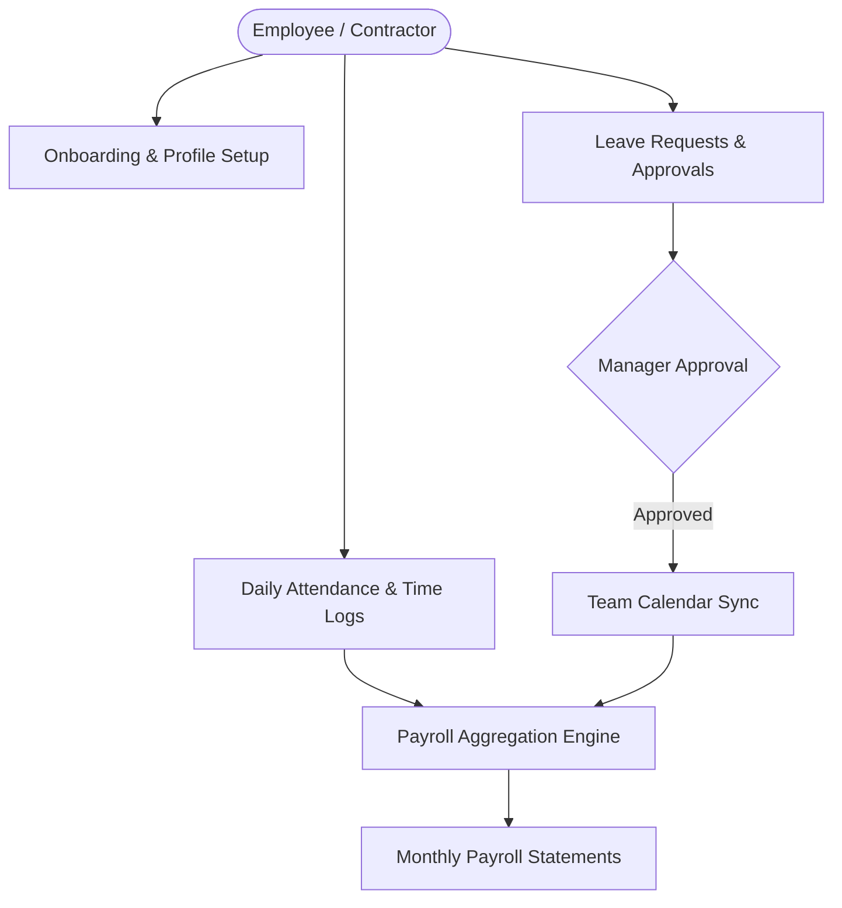

# HR & Team Management

The **180 HR & Team** module provides organizations with a complete workforce operating system. From employee onboarding and role hierarchies to leave management, attendance tracking, and automated payroll calculations, 180 HR unifies team administration without external HRIS software.

---

## 1. Employee Directory & Org Hierarchy

Maintain a centralized directory of full-time staff, part-time employees, and external contractors:

- **Department & Designation Structure**: Organize team members across departments (Engineering, Marketing, Sales, Operations) with explicit reporting managers.
- **Role Assignment**: Assign fine-grained RBAC roles (`ADMIN`, `MANAGER`, `MEMBER`) determining system privileges.
- **Contractor & Freelancer Support**: Differentiate between salaried staff and hourly contractors with separate timesheet and payout rules.

---

## 2. Leave Policies & Approval Workflows

Configure flexible time-off policies tailored to regional labor laws and internal company standards:

- **Leave Types**: Paid Time Off (PTO), Sick Leave, Maternity/Paternity Leave, and Unpaid Leave.
- **Accrual Rules**: Automatic monthly or annual leave balance accruals based on employee tenure.
- **Multi-Level Approval Chains**: Leave requests automatically alert designated managers with one-click approval or rejection.
- **Shared Company Calendar**: Synchronized holiday and leave calendar prevents staffing shortages during critical launch periods.

---

## 3. Attendance Tracking & Billable Time Logs

- **Web & Mobile Clock-In**: Team members log attendance with optional IP restrictions or geolocation verification.
- **Project Timesheets**: Engineers, designers, and consultants log hours directly against active projects and client milestones.
- **Billable vs. Non-Billable Classification**: Accurately split hours for internal productivity tracking and external client invoicing.

---

## 4. Automated Payroll & Salary Sheets

At the end of each billing cycle:
1. **Time & Attendance Aggregation**: The payroll engine compiles approved timesheets, overtime hours, and unpaid leave deductions.
2. **Salary Calculation**: Base salary, performance bonuses, and tax deductions are calculated according to employee compensation profiles.
3. **Approval & Disbursal**: HR leadership reviews and approves the consolidated payroll manifest before routing disbursals through integrated banking rails.
