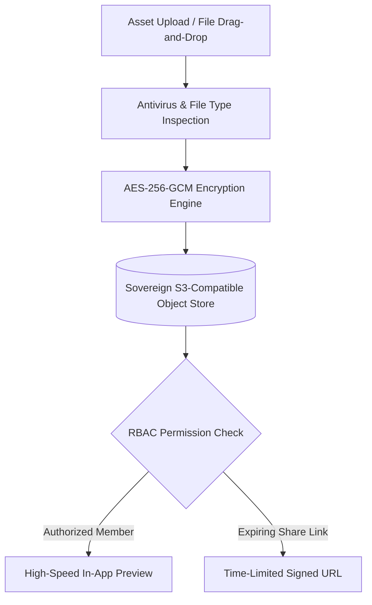

# Storage & Asset Management

The **180 Storage & Assets** module serves as the central digital asset repository for your company. Whether storing high-resolution video footage from **180 Social Studio**, legal contracts from **CRM Deals**, or employee identification documents from **HR**, 180 Storage delivers enterprise-grade encryption, fast edge delivery, and rigorous tenant isolation.

---

## 1. Enterprise File Drive & Folder Organization

- **Hierarchical Directory Tree**: Organize documents, client folders, media assets, and operational templates with ease.
- **Unified Search & Tagging**: Full-text metadata search across file names, file types, uploaders, and associated project tags.
- **In-Browser File Previews**: Native rendering for PDFs, high-resolution imagery (PNG, JPEG, SVG, WebP), audio files, and 4K video clips without requiring local downloads.

---

## 2. Multi-Tenant File Isolation & Security

In 180 Workspace, file security is enforced at every layer:

- **Isolated Storage Buckets / Path Partitioning**: Every file is prefixed with the parent `companyId`, ensuring that tenant directories are mathematically segregated at the object storage level.
- **AES-256 Encryption at Rest**: All stored assets are encrypted using industry-standard AES-256-GCM encryption with rotatable customer master keys.
- **Signed URL Access**: Files are never served via public, unauthenticated URLs. Instead, temporary pre-signed URLs are generated with short-lived TTLs (e.g. 15 minutes) upon verified user requests.

---

## 3. Granular Permission Matrices

Control folder and asset accessibility across teams and external guests:

| Access Level | View Files | Upload New | Edit / Rename | Delete Asset | Share Public Link |
| :--- | :--- | :--- | :--- | :--- | :--- |
| **Owner / Admin** | Yes | Yes | Yes | Yes | Yes |
| **Editor / Manager** | Yes | Yes | Yes | No | Yes |
| **Contributor** | Yes | Yes | Only Owned | Only Owned | No |
| **Viewer / Guest** | Yes | No | No | No | No |

---

## 4. Public File Sharing with Expiring Links

Share files with clients or external partners securely:
- **Time-Limited Links**: Set link expiration times (1 hour, 24 hours, 7 days, or custom date).
- **Password Protection**: Optional alphanumeric passphrase required before downloading sensitive documents.
- **Download Audit Log**: Track exactly when, where, and how many times a shared asset was viewed or downloaded.
