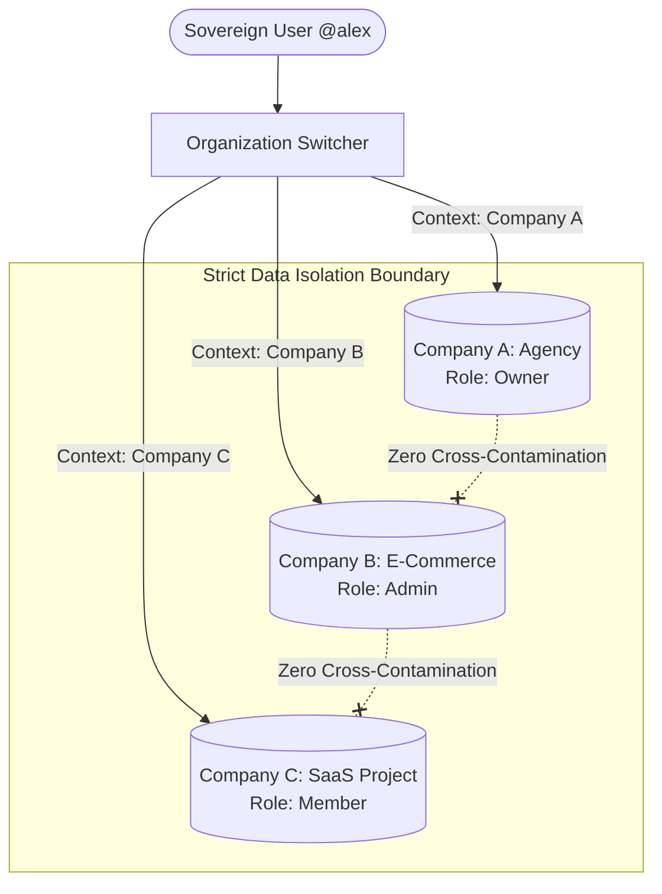

# Multi-Company Management & Tenant Isolation

Modern founders, multi-brand holding groups, and marketing agencies frequently operate more than one business entity. In traditional software, managing three companies requires logging in and out of three separate accounts, maintaining multiple email addresses, and paying separate base subscription plans.

**180 Workspace** solves this with native **Multi-Company Management** built directly into the top-level application navigation.

---

## 1. Instant 1-Click Company Switching

From the workspace header, users can switch between organizations in milliseconds:

- **State Preservation**: The active workspace context updates globally across all modules without refreshing the entire browser.
- **Dynamic RBAC Adaptation**: A user can be the `OWNER` of Company A, an `ADMIN` in Company B, and a read-only `VIEWER` in Company C. Permissions adapt automatically when switching contexts.
- **Unified Global Notifications**: High-priority alerts across all companies (such as urgent approval requests or overdue invoices) can be viewed in a centralized notification feed.

---

## 2. Strict Tenant Isolation Guarantees

Every company created in 180 Workspace exists inside an airtight tenant container:

1. **Unique Tenant Identifier (`companyId`)**: All database tables (`Deal`, `Contact`, `Employee`, `Invoice`, `FileAsset`) require a foreign key binding to `companyId`.
2. **Automated ORM Partitioning**: Internal database query layers automatically inject `WHERE companyId = :currentCompanyId` on all read and write queries.
3. **No Cross-Company Information Leakage**: Even if an employee belongs to multiple companies, team directories, customer contact books, and accounting ledgers never leak between tenant contexts.

---

## 3. Creating & Managing Organizations

### Creating a New Company
1. Open the Company Switcher dropdown and select **Create New Workspace**.
2. Enter the legal entity name, primary operational currency, timezone, and fiscal calendar year.
3. Invite foundational team members and assign initial roles (`ADMIN`, `MANAGER`, `MEMBER`).

### Organization Settings & Custom Domains
- **Branding & Logos**: Upload distinct brand identities, invoices logos, and color palettes per company.
- **Custom Domain Routing**: Connect custom CNAME domains (e.g. `workspace.youragency.com`) with automated SSL certificate provisioning.
- **Data Export & Sovereignty**: Export complete company data archives in JSON or SQL formats at any time.
